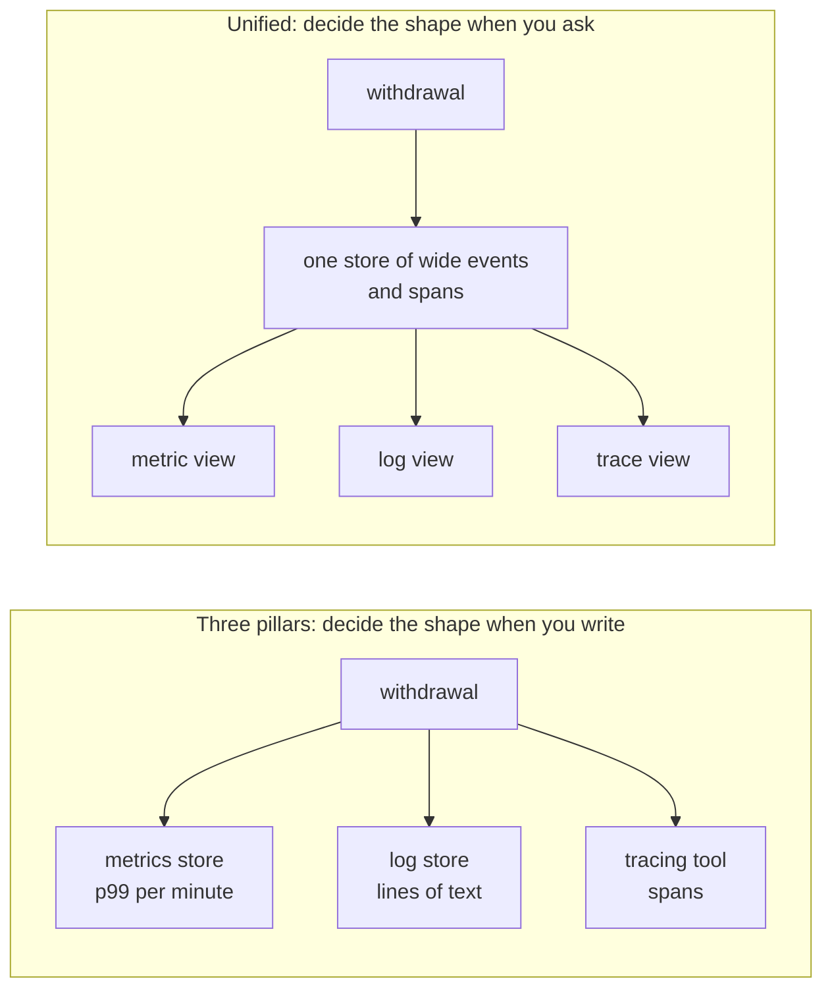
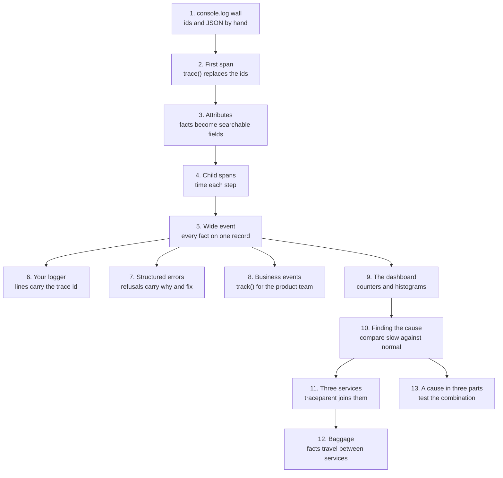
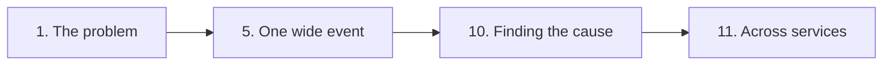

# Node.js OpenTelemetry Workshop

From `console.log` to one trace across three services, in thirteen parts. This is
the Node.js edition; each other language gets its own repository.

Read it as a website at
[jagreehal.github.io/nodejs-opentelemetry-workshop](https://jagreehal.github.io/nodejs-opentelemetry-workshop/),
or run the same site next to your editor with `pnpm docs`.

## The scene

A customer calls on a Saturday morning. The machine on Bridge Street took eleven
seconds to give them £40, and they want to know whether the money left their
account twice.

You have logs. You wrote them.

```
withdrawal started
withdrawal started
withdrawal started
user found: Ada Okafor
user found: Bruno Salas
pin ok
pin ok
```

Five machines were busy at that moment, so five withdrawals wrote into the same
stream at once. A `pin ok` line does not say which customer it belongs to, and
no line says how long its step took. Every line is true, and the log still
cannot tell you which of the four steps ate the eleven seconds.

Over thirteen parts you take that output to a trace that spans three services. By the
end you can pick out one customer's withdrawal and see which operation took the
time. An optional last part finds the withdrawals behind a slowdown that
needs three conditions at once.

## What observability means

The word comes from engineering. In 1960 Rudolf Kálmán asked whether you can
work out what is happening inside a machine only from what it shows on the
outside. If a fact never shows up in any output, you cannot recover it later.
_Observability Engineering_ carries the idea into software (Chapter 1):

> The ability to understand or debug any given system state

For you, that means explaining something odd in production from the data your
code already sent out, without adding a log line and waiting for it to happen
again.

**Monitoring** answers questions you set up in advance: is the machine up, is
the error rate over its threshold. It tells you that something is wrong, and
often where. It cannot tell you why, and it cannot answer a question nobody
configured. The book calls the first kind **known unknowns**: you know the
question and wait for the answer, the way a smoke alarm waits for smoke.
**Unknown unknowns** are problems you did not know to look for, and you find
them by asking new questions of data you already recorded (Chapter 3). "Why did
one withdrawal on Bridge Street take eleven seconds?" is one. No dashboard had
a panel for it.

The book's analogy fits this bank. Checking your own balance now and then is
monitoring. Running the bank, where you must trace any transaction between any
two accounts on demand, is observability.

### Instrumentation and OpenTelemetry

**Instrumentation** is code you add so your application reports what it does
as it runs. The book compares it to the traffic sensors and utility meters a
city planner installs (Chapter 4). From a plane at night you see the city's
lights flicker and the traffic move, and you cannot say why a road jams until
someone puts sensors on it. The data those sensors send is **telemetry**.

**OpenTelemetry** (OTel) is an open standard for telemetry: a common format,
plus libraries in each language that produce it. The book calls it a universal
translator (Chapter 4). Your code speaks OpenTelemetry once, and Honeycomb,
Grafana, Datadog or the local devtools in this workshop can all read it.

OpenTelemetry rests on three building blocks:

- **Signals** are the data itself: traces, metrics and logs.
- **Context** ties the signals together. It records which request and which
  step produced each piece of data, so a log line and a span from the same
  withdrawal carry the same trace ID.
- **Semantic conventions** are shared names. `http.request.method` means the
  same thing in your code, your cloud provider's data and every tool that
  reads either.

OpenTelemetry stops at producing and sending the data. It stores nothing and
draws no charts. A **backend** does that part: Honeycomb, Grafana, Datadog,
Better Stack, SigNoz. In this workshop, devtools plays the backend.

### Three views of one withdrawal

Most teams store each kind of telemetry in its own tool: **metrics** (numbers
over time) in one database, **logs** in a log store, **traces** in a tracing
tool. The book calls this the three pillars model. Each pillar sees a different
slice of the eleven-second withdrawal:

| Signal     | What it records                                          | What it tells you about Bridge Street                                                |
| ---------- | -------------------------------------------------------- | ------------------------------------------------------------------------------------ |
| **Metric** | One number summarising many withdrawals, such as p99 (the time 99 in 100 beat) | Withdrawal latency went up. It cannot say for which customer or in which step.       |
| **Log**    | One line per thing that happened                         | Each step happened. You rebuild the timeline yourself from interleaved timestamps.   |
| **Trace**  | Timed, nested spans for one request                      | The four steps of this one withdrawal and how long each took.                        |

Each signal also has a job it does best. Take a process that dies because it
ran out of memory. The log line says it died, and why. A metric of memory in
use shows it climbing toward 90% for the hour before, and an alert on that
metric could have paged someone before the crash. A trace shows which request
was running, and where it spent its time, when memory ran out. This workshop
leans on detailed records, and part 9 shows where a metric is the better tool.

This workshop takes the other approach the book describes, the **unified
model**. You record one detailed record per withdrawal with every fact
attached, and build the chart, the log line or the trace from those records
when you ask the question:



The difference matters because aggregation only runs one way, like a
blender: you can turn fruit into a smoothie, and you cannot turn the smoothie
back into fruit. A metric store keeps the p99 and throws away the withdrawals
it came from, so you
cannot go back and split that p99 by branch or by customer. A store of raw
events can compute the p99 today and split it by any field tomorrow, including
a field you only learn matters in part 10.

## Who this is for

You have shipped software and you debug it with `console.log`. You may have
opened the OpenTelemetry documentation and found it assumed too much. You do
not need to know what a span, OTLP or a collector is. Each part introduces the
terms its exercise needs, and the [Terms](#terms) table below collects them.

Plan for half a day at a steady pace. You need TypeScript and Node 22 or newer.
The workshop needs no hosted account and no Docker.

## Setup

```sh
node --version    # 22 or newer
corepack enable
pnpm install
pnpm devtools     # leave this running in its own terminal
```

`pnpm devtools` starts a small local server on `http://127.0.0.1:4318` that
receives the telemetry your code sends, with a web UI to browse it. Open it in a browser and keep the tab open for the whole workshop. From part
2 onward you read that tab instead of stdout to see what your code did.

> If the banner prints a different port, something else already holds 4318.
> Start devtools on a free port and tell your code where to send its data:
>
> ```sh
> pnpm devtools 4319
> export OTEL_EXPORTER_OTLP_ENDPOINT=http://127.0.0.1:4319
> ```

Then, in a second terminal:

```sh
pnpm ex 01    # run part 1's exercise, and re-run it each time you save
pnpm sol 01   # run our solution to part 1
```

Both commands use `tsx watch`, so your loop is edit, save, look at the trace.

If a run ends with `Flush timeout after 2000ms. No collector acknowledged the
export`, your code tried to send its data and nothing answered. Either devtools
is not running, or it listens on a port other than the one your code sends to.
Start it, or set `OTEL_EXPORTER_OTLP_ENDPOINT` to match its banner.

## How each part goes

1. **A scene.** Something has gone wrong, or someone has asked a question your
   current data cannot answer.
2. **Predict.** Each part opens with a question. Write your answer somewhere you
   cannot edit later. People skip this step, and it is the step that
   teaches.
3. **Your turn.** `exercise.ts` runs as it is and lacks one idea. You add it.
4. **Our solution.** `solution.ts` runs too, and the part's README explains the
   shape we chose and what it costs.

You get no failing test suite. You check your work by looking at the trace in
the devtools tab, because that is the feedback you will have at work.

## The thirteen parts

| #                                                    | You will                                                     | Predict before you start                                                                                   |
| ---------------------------------------------------- | ------------------------------------------------------------ | ---------------------------------------------------------------------------------------------------------- |
| [1](src/01-the-console-log-wall/README.md)           | Watch five concurrent withdrawals scramble a log             | How would you find out how long one customer's withdrawal took?                                            |
| [2](src/02-your-first-span/README.md)                | Replace hand-rolled ids and timers with one wrapper          | Five concurrent calls, nothing passed between them. How does each call know it is not the first?          |
| [3](src/03-attributes-not-messages/README.md)        | Move the facts out of strings and onto the span              | `atm.model` has two values, `transaction_id` has millions. Which is worth recording?                       |
| [4](src/04-which-work-deserves-a-span/README.md)     | Decide which of six operations get their own span            | Which of the six earn a span, and which do not?                                                            |
| [5](src/05-one-wide-event/README.md)                 | Gather every fact of a withdrawal onto one record            | Each fact already sits on one of five spans. What do you gain by gathering them all onto the root span?    |
| [6](src/06-logs-you-already-have/README.md)          | Keep your logger and stamp every line with its trace id      | `init()` runs on the first line of the file. Why do the log lines still have no trace id?                  |
| [7](src/07-errors-that-explain-themselves/README.md) | Make six refusals say what to do next                        | Three audiences for one failure. Three error types, or one?                                                |
| [8](src/08-events-the-business-asks-for/README.md)   | Answer a product question without a devtools tab             | Your spans hold the numbers already. What is left for a separate event to do?                              |
| [9](src/09-the-dashboard/README.md)                  | Build the dashboard: a counter and a histogram per branch    | A histogram costs the same at any traffic. What question can it never answer?                              |
| [10](src/10-finding-the-cause/README.md)              | Find why 16 withdrawals of 200 are slow                      | p50 flat, p99 quadrupled. All customers a little, or a few a lot?                                          |
| [11](src/11-one-trace-three-services/README.md)       | Put one trace back together across three processes           | Every service is instrumented and exports to the same place. What is missing?                              |
| [12](src/12-facts-that-travel/README.md)             | Carry a fact to a service that never asked for it            | You could add a parameter. What breaks when the fourth service arrives?                                    |
| [13](src/13-a-cause-in-three-parts/README.md)        | Optional, advanced, ~30 min: a canary slowdown in a 3-way cohort | Four labels each point at a slow value. One cause, all of them, or a combination?                         |

Each part keeps what the previous one built and adds one idea:



## If you only have ninety minutes

Do parts 1, 5, 10 and 11. Part 1 shows the problem and part 5 shows the shape of
the answer. Part 10 is the payoff, and part 11 decides whether any of it survives
contact with your own architecture.



Save part 4 for a day when you have someone to argue with about it.

Part 13 is optional. For a session about investigation, run it straight after
part 10.

## What is in here

```
src/bank/          the domain: users, cards, accounts, a ledger
src/NN-name/       one part: README.md, exercise.ts, solution.ts
                   (part 6 adds instrumentation.ts, loaded before the app)
scripts/           run.mjs starts a part; check.mjs verifies every part
docs/              the website, built from these READMEs
tools/oxlint/      lint rules that keep the code free of common slop
```

`src/bank/` never imports autotel and never changes. It stays constant across
all thirteen parts while the observability varies. When part 7 looks different from
part 5, the difference is the lesson.

One fact about the bank is worth knowing up front: the PIN attempt counter
survives between requests. A customer can lose their card because of something
that happened in an earlier withdrawal, and no function signature mentions it.

## Terms

| Term                          | Meaning here                                                                                                                                               |
| ----------------------------- | ---------------------------------------------------------------------------------------------------------------------------------------------------------- |
| **Observability**             | Your ability to understand or debug any state your system gets into, including states you never predicted, from the data it emits. |
| **Instrumentation**           | Code you add so your application emits data about what it does as it runs. Parts 1 and 2.                                                                |
| **Telemetry**                 | The data instrumentation sends out: spans, logs, metrics and events.                                                                                     |
| **OpenTelemetry (OTel)**      | An open standard for telemetry, plus libraries that produce it, so any vendor's tool can read your data.                                                 |
| **Unit of work**              | One thing your system does that you want a record of. Here, one withdrawal. Part 1.                                                                      |
| **Structured event**          | A record of one unit of work as key-value pairs a machine can parse, such as a JSON log line. Part 1.                                                    |
| **Signal**                    | One of OpenTelemetry's three kinds of data: traces, metrics and logs.                                                                                      |
| **Backend**                   | The tool that stores telemetry and lets you query it, such as Honeycomb or Grafana. Devtools plays it here.                                              |
| **Metric**                    | A number kept up to date across many requests, such as requests per minute or p99 latency. The individual requests are gone. Part 9.                     |
| **Counter / histogram**       | Two kinds of metric. A counter only goes up. A histogram counts how many values land in each range, called a bucket. Part 9.                              |
| **Log correlation**           | Stamping each log line with the trace ID and span ID of the request that wrote it. Part 6.                                                               |
| **Span**                      | One timed operation: a name, a start time, a duration, a status and key-value fields. Part 2.                                                              |
| **Trace**                     | The tree of spans that one request produced. All its spans share a trace ID. Part 2.                                                                       |
| **Attribute**                 | A key-value field on a span, such as `user.id = "u_007"`. You filter and group by attributes. Part 3.                                                      |
| **Cardinality**               | The number of distinct values a field can take. `atm.model` has two; `withdrawal.transaction_id` has one per withdrawal. Part 3.                            |
| **Context**                   | The record of which span is running right now: its trace ID and span ID. Node keeps a separate one for each withdrawal, even when five run at once. Parts 2 and 11. |
| **Wide event**                | One record per unit of work holding every fact that unit knew. Also called a canonical log line. Part 5.                                                   |
| **Business event**            | A record of something a customer did, named for the product team (`atm.cash_withdrawn`) and sent to an analytics tool. Part 8.                             |
| **p50 / p99**                 | Percentiles of duration. Half of requests finish faster than p50; 99 in 100 finish faster than p99. Part 10.                                                |
| **W3C `traceparent`**         | The HTTP header that carries a trace ID and parent span ID from one service to the next, defined by the W3C Trace Context standard. Part 11.                 |
| **Baggage**                   | Key-value pairs that travel with a request to every downstream service in the `baggage` header. Part 12.                                                   |
| **Collector**                 | A relay between your services and a backend. It receives telemetry, processes it, and forwards it on. See below.                                         |

## Taking this to work

The workshop runs everything on your laptop against devtools. A real service
needs five changes, most of them small.

1. **Load the setup before the app.** Put `init()` in its own file and start
   the service with `node --import ./instrumentation.js app.js`. Part 6 shows
   why: a library loaded before `init()` never gets instrumented, and nothing
   warns you.
2. **Turn on automatic instrumentation.** Libraries such as `http`, Express,
   Postgres and Redis have ready-made instrumentation that creates spans for
   every request and query. In autotel, install
   `@opentelemetry/auto-instrumentations-node` and add
   `autoInstrumentations: ['http', 'express']` to `init()`. Your own `trace()`
   spans nest inside theirs.
3. **Keep your logger.** Add its instrumentation so every line carries a
   trace ID (part 6).
4. **Send to a backend, usually through a collector.** Point
   `OTEL_EXPORTER_OTLP_ENDPOINT` at your backend or at an OpenTelemetry
   Collector. A collector sits between your services and the backend:

   ```mermaid
   flowchart LR
     S1["atm"] --> R
     S2["auth-service"] --> R
     S3["accounts-service"] --> R
     subgraph C["OpenTelemetry Collector"]
       R["receivers<br/>accept OTLP"] --> P["processors<br/>batch, filter,<br/>redact, sample"]
       P --> X["exporters<br/>send on"]
     end
     X --> B1["your backend"]
     X --> B2["a second backend"]
   ```

   With a collector, your services send to one address and never change,
   while the team that runs the collector chooses backends, strips secrets
   and decides what to keep.
5. **Sample.** At real traffic you keep a share of traces rather than all of
   them. Part 12 explains how to choose which ones, and how to count what you
   kept.

If an AI assistant writes the instrumentation, review its work the way you
would review a junior engineer's pull request. It is good at the boilerplate:
wrapping functions in `trace()` and filling in standard attribute names. It
cannot know that `account.shard` is the field your next incident turns on.
Check each name against part 3's conventions, and check each span against part
4's rules.

### What this workshop leaves out

The same model, wide events joined by context, reaches past one backend
service. These topics are not covered here:

- **SLOs in a real backend.** Part 7 builds the SLI by hand. Most backends can
  store it, track the error budget and fire burn alerts (Chapters 11 and 12).
- **CI pipelines.** Treat each pipeline run as a trace and each job and step
  as a span. OpenTelemetry's `cicd.*` conventions name the fields, and the
  `TRACEPARENT` variable from part 11 joins the steps (Chapter 18).
- **Browsers and mobile apps.** A session id carried from the device through
  every backend call (Chapter 19).
- **LLM calls.** One span for each model call, with token counts under the
  `gen_ai.*` conventions, and an eval score recorded as an attribute
  (Chapter 21).

## Where this came from

The arguments in these READMEs come from _Observability Engineering_, second
edition, by Charity Majors, Liz Fong-Jones, George Miranda and Austin Parker
(O'Reilly). Quotes from the book appear as block quotes. The book supplies the
reasoning; this repository turns the same reasoning into code you can break.

The library is [Autotel](https://github.com/jagreehal/autotel), which produces
OpenTelemetry data. To send everything you write here to Honeycomb, Grafana,
Datadog, SigNoz or an OpenTelemetry Collector (a relay that forwards telemetry
on), you change the `endpoint` in `init()` and nothing else.
That portability is the reason to learn the model before any vendor's UI.

## Checks

```sh
pnpm check
```

The command type-checks and lints the repository, runs each exercise and
solution against a throwaway receiver, and checks what arrived against the
lines at the top of each file: `// check:` for spans, `// check-metric:` for
metrics and `// check-log:` for log records. A library upgrade that breaks a part fails this command before it
costs a learner an afternoon.
