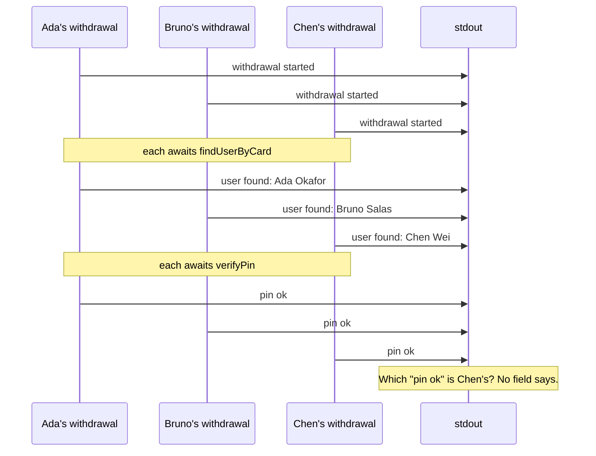

# Part 1: The console.log wall

## The scene

It is 09:14 on a Saturday. A customer calls: the machine on Bridge Street took
eleven seconds to give them £40, and they want to know whether the money left
their account twice.

You have the logs. You wrote them.

```ts
console.log('withdrawal started');
console.log('user found:', user.name);
console.log('pin ok');
console.log('account found, balance', account.balancePence);
console.log('debited, new balance', receipt.balancePence);
console.log('withdrawal complete');
```

Run the code you shipped:

```sh
pnpm ex 01
```

## Predict, before you run it

Write your answer down where you cannot edit later.

> Five withdrawals run at once. Looking only at that output, how would you find
> out how long Chen Wei's withdrawal took?

## What you get

```
withdrawal started
withdrawal started
withdrawal started
withdrawal started
withdrawal started
user found: Ada Okafor
user found: Bruno Salas
...
```

Each line describes a withdrawal, and no field says which one.

The five calls share one process and one stdout. Node runs one piece of your
code at a time. When Ada's withdrawal waits on the bank with `await`, Node
moves on to Bruno's until Ada's answer comes back. The lines arrive in the
order the steps finished, mixed across customers. Here are three of the five:



In this run the steps take the same time, so the lines come out in batches. In
production a slow step reorders them, and the batches break apart.

A timestamp on each line records when a step finished. It cannot tell you which
withdrawal the step belonged to. You rarely notice this on your laptop, because
one request at a time owns the stream. Production runs many requests at once
and interleaves them.

The output lacks three things:

| Missing       | Why it hurts                                                       |
| ------------- | ------------------------------------------------------------------ |
| **Identity**  | No field ties a line to the withdrawal that wrote it               |
| **Duration**  | You logged that a step happened, and never how long it took        |
| **Structure** | `'user found: Ada Okafor'` is prose, and you cannot filter on prose |

To count how many withdrawals Ada made this morning, you would need a regular
expression that pulls her name back out of `user found: Ada Okafor`. That
expression breaks the day someone rewords the message.

## Your turn

Open `exercise.ts` and change the logging so you can answer the question above.
Do not reach for a library. Use what Node gives you.

You may change anything except the four `bank/` functions.

## Our solution

```sh
pnpm sol 01
```

```ts
interface LogFields {
  amountPence?: number;
  userId?: string;
  accountId?: string;
  transactionId?: string;
  durationMs?: number;
}

function log(withdrawalId: string, event: string, fields: LogFields = {}) {
  console.log(
    JSON.stringify({ t: Date.now(), withdrawalId, event, ...fields }),
  );
}

const withdrawalId = randomUUID().slice(0, 8);
const startedAt = Date.now();
log(withdrawalId, 'withdrawal.started', { amountPence });
// ...
log(withdrawalId, 'withdrawal.completed', {
  durationMs: Date.now() - startedAt,
});
```

You made two changes. Each line carries an id, and each line is a JSON object
instead of a sentence. `pnpm sol 01 | grep 9f2c41aa` now prints one customer's
withdrawal, and `durationMs` answers the caller's question.

### Why this solution

Two definitions from _Observability Engineering_ (Chapter 5) name what you
built. An **event** is the record of one **unit of work**, here one
withdrawal. A **structured event** stores that record as named key-value pairs
a program can read, such as JSON. `console.log('pin ok')` hands a tool one
sentence. Your JSON line hands it named fields, and a log tool can treat each
key as a column, the way a spreadsheet does. The book treats a structured log
line and a structured event as the same thing.

Columns change the question you can ask. To count Ada's withdrawals from the
old output, you pull her name out of prose with a regular expression. From the
new output you filter on a field, `userId = 'u_001'`, and the filter survives
someone rewording a message.

The id changes the query too. The book describes the same move:

> Many developers stumble onto the same idea: give each request a unique ID and
> add it to each log line.

`WHERE withdrawalId = '9f2c41aa'` now returns one customer's withdrawal. The
book gives tracing a starting mental model that fits this: "a set of
events that all share the same ID." You have built the first piece of a trace.

### What it still does not do

A trace needs five fields on each record before a tool can draw it (Chapter 5).
Picture a restaurant order. The number on the ticket follows the order from
till to kitchen to table: that is the **trace ID**. Each station records its
own step with a step number (**span ID**), when it started, how long it took,
and which step it was part of (**parent ID**). Your solution has some of these
fields:

| Field needed    | What it means                                  | Your part 1 solution                              |
| --------------- | ---------------------------------------------- | ------------------------------------------------- |
| **Trace ID**    | One id shared by every record of the request   | `withdrawalId`                                    |
| **Timestamp**   | When this piece of work began                  | `t`                                               |
| **Duration**    | How long this piece of work took               | Only on `withdrawal.completed`, for the whole run |
| **Span ID**     | An id for this one piece of work               | Missing                                           |
| **Parent ID**   | The id of the work this piece ran inside       | Missing                                           |

The gaps cost you the customer's question. When the Bridge Street machine
takes eleven seconds, `durationMs: 11004` confirms their story and tells you
nothing more. The data does not say which of the four steps took the time, and
you cannot go back for it, because the run has finished.

To fill the gaps you would time each step, give each step an id, and record
which step ran inside which. At that point you have written a tracing library
yourself, and you own its bugs. The solution prints three more gaps, including
what happens when the debit moves to another service; part 11 answers that one.

Part 2 fills all five fields with one wrapper.

---

Next: [Part 2: Your first span](../02-your-first-span/README.md)
