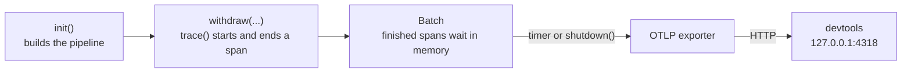
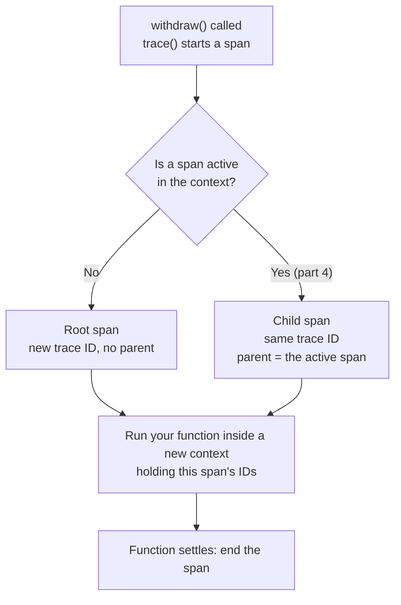
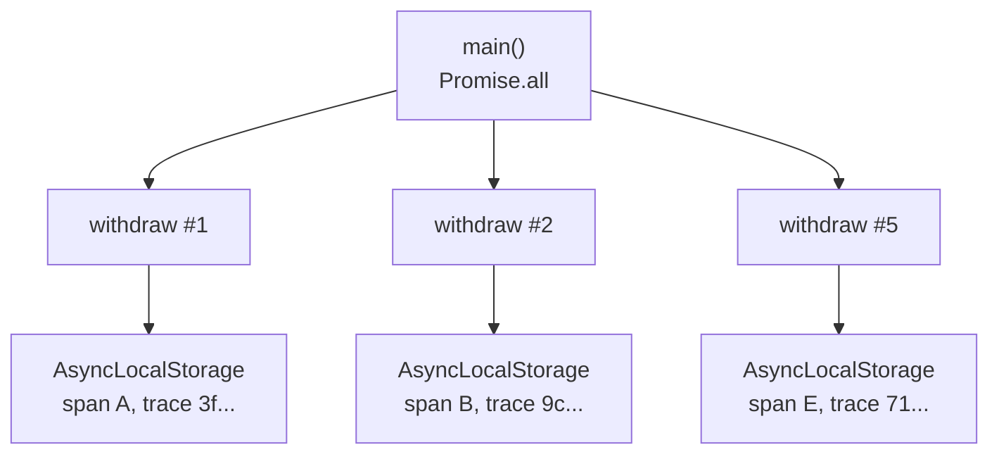

# Part 2: Your first span

## The scene

You shipped part 1's solution, and it helped. Then the Bridge Street machine
went slow again. You grepped one withdrawal out of the noise, and this was the
whole record of eleven seconds:

```json
{
  "withdrawalId": "9f2c41aa",
  "event": "withdrawal.completed",
  "durationMs": 11004
}
```

You need the same record with each step timed and nested inside the
withdrawal, and you would rather not write and maintain that code yourself.

## Setup, once for the whole workshop

Open a second terminal and leave it running:

```sh
pnpm devtools
```

The command starts a local receiver on `http://127.0.0.1:4318` with a UI. Open
it in a browser and leave the tab open. For the next eleven parts you read that
tab, in place of stdout, to see what your code did.

> If the banner prints a different port, something else already holds 4318.
> Start devtools on a free port and point the exporter at it:
>
> ```sh
> pnpm devtools 4319
> export OTEL_EXPORTER_OTLP_ENDPOINT=http://127.0.0.1:4319
> ```

## Predict, before you run it

> `trace()` wraps a function. When five wrapped calls run at the same time in one
> process, how does the fifth call know it is not the first? Nothing is passed
> between them.

## Your turn

`exercise.ts` holds part 1's solution, unchanged. You have three TODOs:

1. Call `init()` once, at the top of the file, before any traced code runs.
2. Wrap `withdraw` so each call becomes one span.
3. Make sure the spans leave the process before it exits.

`autotel` exports everything you need. Try it before reading on.

```sh
pnpm ex 02
```

## Our solution

```sh
pnpm sol 02
```

```ts
import { init, trace, shutdown } from 'autotel';

init({ service: 'atm', devtools: true });

const withdraw = trace(
  'atm.withdraw',
  async (cardNumber: string, pin: string, amountPence: number) => {
    const user = await findUserByCard(cardNumber);
    await verifyPin(cardNumber, pin);
    const account = await getAccount(user.id);
    return debit(account, amountPence);
  },
);

// ...after the work
await shutdown();
```

Open the devtools tab. You will see five traces named `atm.withdraw`, each with
its own duration. The `randomUUID`, the `Date.now()` arithmetic and the `log()`
helper are gone, and you lost nothing with them.

### Two words you now need

A **span** records one unit of work: a name, a start time, a duration, a
status, and any key-value fields you add. A **trace** is the set of spans one
request produced. The **root span** is the top one, the span with no parent.
Right now each trace holds only its root span. In part 4 you add child spans
underneath it.

A span is a structured log line with a few extra fields. Put your part 1 line
next to one:

| Span field         | What it holds                                                         | Part 1 equivalent             |
| ------------------ | --------------------------------------------------------------------- | ----------------------------- |
| **Trace ID**       | A random 32-character ID shared by every span in the trace            | `withdrawalId`                |
| **Span ID**        | A random 16-character ID for this span alone                          | none                          |
| **Parent span ID** | The span ID of the work this span ran inside. Empty on the root span. | none                          |
| **Start time**     | When the work began                                                   | `t`                           |
| **Duration**       | How long the work took                                                | `durationMs`, whole run only  |
| **Name**           | What the work was, such as `atm.withdraw`                             | `event`                       |
| **Service name**   | Which deployable did the work, `atm` here                             | none                          |

The first five fields are the ones part 1 listed as the minimum a trace needs,
the order number and step stamps on the restaurant ticket.
From them, devtools draws a **waterfall**: one bar per span, placed at its
start time, as long as its duration, and indented under its parent.

_Observability Engineering_ (Chapter 5) sums up the whole mechanism:

> Let's peel back the layers to demystify tracing into a mental model that looks
> a lot like "fancy logs" combined with "context propagation" (in other words,
> "passing some IDs around").

The "fancy logs" half is the table above. The "passing some IDs around" half is
the next section.

**Name spans for the kind of work, and keep them groupable.** Every withdrawal
produces a span named `atm.withdraw`, so you can group all of them and compare.
A name such as `withdraw-u_007` would give each customer their own name and
break that grouping. The book's rule (Chapter 7): keep identifiers out of span
names and put them in attributes, which part 3 covers.

### Why this solution

**You call `init()` once per process, and it finishes its work before it returns.** It sets up
the pipeline, the path each span takes from your code to devtools: where spans
go, what the service is called, and which fields go on every span. Because it finishes before the next line runs, no span can start
before the pipeline exists. You will filter on `service: 'atm'` later, so name
it after the deployable and leave the file name out of it.

**`devtools: true` configures the whole backend.** It tells the exporter to
send spans to `http://127.0.0.1:4318`, where `pnpm devtools` listens. An
**exporter** is the component that sends finished spans out of your process.
It speaks **OTLP**, the OpenTelemetry Protocol: the standard format for
sending telemetry over the network, so any tool that accepts OTLP can receive
your spans. If you set `OTEL_EXPORTER_OTLP_ENDPOINT`, the exporter sends there
instead. Swap `devtools: true` for an `endpoint` and the same code streams to
Honeycomb, Grafana, Datadog or a **collector**, a relay service that receives
telemetry and forwards it on.

**`trace(name, fn)` returns a wrapper and runs nothing.** `withdraw` stays a
function you call. You can declare the wrapper at module scope and nothing
starts during import. Each call to the wrapper starts a span, runs your
function, and ends the span when the promise settles.



**A library can call `trace()` safely before anyone calls `init()`.** The
wrapper runs your function and records nothing, and `ctx.traceId` comes back
`undefined`. OpenTelemetry splits the functions you call (the **API**) from
the machinery that records and sends (the **SDK**), on purpose (Chapter 4). A
library author can instrument their code, and it costs nothing in an app that
never plugs the machinery in. `init()` plugs it in.

**You write these spans by hand, and that is one of two ways to get them.**
OpenTelemetry also ships automatic instrumentation, which wraps HTTP clients,
servers and database drivers for you with a few lines of config. Automatic
instrumentation cannot know that four calls add up to one withdrawal, or that a
refusal on the daily limit is a business outcome. The book's advice (Chapter
4) is to use both: automatic for the plumbing, custom for the operations your
business cares about. This workshop writes everything by hand so you see each
mechanism once.

### Concurrent context

The word **context** means several things in observability, and the book
flags that (Chapter 7). In this workshop it means one thing: the small record
of which span is running right now. For tracing it holds two values, the trace
ID and the current span ID. Every `trace()` wrapper reads it when a span starts:



That answers the prediction question. The fifth call does not need to know
about the other four. It reads the context, finds no active span, and starts a
trace of its own. So do the other four.

Node keeps a separate context for each call through `AsyncLocalStorage`, a
built-in store. Think of it as a name badge each withdrawal wears. Any code
that runs for Ada's withdrawal, including the code after each `await`, can read
her badge, and never Bruno's. `trace()` pins the new span's IDs to the badge
before it calls your function. Five concurrent `withdraw` calls wear five
badges, and each sees only its own span. Nothing passes through your function
signatures.



Other languages move the same two IDs by other means; Go passes a `ctx`
argument through each function by hand. The mechanism has a name:
**propagation**. Moving the context between functions inside one running
program is intraprocess propagation, and `AsyncLocalStorage` does it for you
here. Moving it between programs, say from the ATM to a separate auth service,
is interprocess propagation, and nothing does it for you until part 11.

### Where the badge falls off

`AsyncLocalStorage` follows the code that a call starts: each `await`,
`setTimeout` or promise it creates inherits its badge. It does not follow the
data. A background worker started once at boot runs every job under the boot
context, whoever queued the job:

```ts
// writeAudit and sendReceipt are wrapped in trace() as write_audit and send_receipt
const jobs: Array<() => Promise<void>> = [];
setInterval(() => jobs.shift()?.(), 10); // started at boot, no span active

const withdraw = trace('atm.withdraw', async () => {
  jobs.push(() => writeAudit()); // queued inside the withdrawal's span
  setTimeout(() => sendReceipt(), 0); // started inside it
});
```

```
atm.withdraw   trace 852f190997ba252b7da482de0ecdb3c9
send_receipt   trace 852f190997ba252b7da482de0ecdb3c9
write_audit    trace b9bffa4ee4890bd0266d70f67aade970
```

The receipt joins the withdrawal's trace. The audit write starts a trace of its
own, and nothing warns you. When an object was created does not decide this.
An ordinary `EventEmitter` runs its listeners inside `emit()`, so they see the
context of whoever called `emit()`. What loses the context is a scheduling
boundary like this worker's: work stored now and run later from a callback
that some other context started. Some queue, pool and driver libraries do that
inside their own code. Node's `AsyncLocalStorage` and `AsyncResource` docs
cover where context does and does not follow. The fix is the one part 11 uses
across a network: put the context in the job itself, and restore it where the
job runs.

### One thing to notice before moving on

Comment out `await shutdown()` and run it again. The exporter works like a
post van. It collects finished spans in a bag, the **batch**, and drives them
to devtools every few seconds. A long-running server sees the van come round
many times. A short script exits before the first round, and the bag is lost.
`shutdown()` **flushes** the batch, which means it sends the van out now with
whatever is waiting, then closes the exporter.

If the flush finds no receiver, the run ends with `Flush timeout after 2000ms.
No collector acknowledged the export`. That message means devtools is not
running, or it runs on a port other than the one the exporter targets.

---

Previous: [Part 1: The console.log wall](../01-the-console-log-wall/README.md) ·
Next: [Part 3: Attributes, not messages](../03-attributes-not-messages/README.md)
