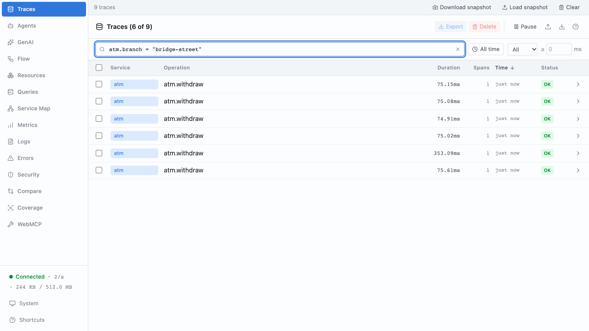
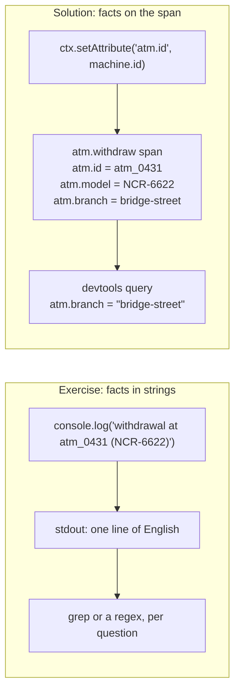
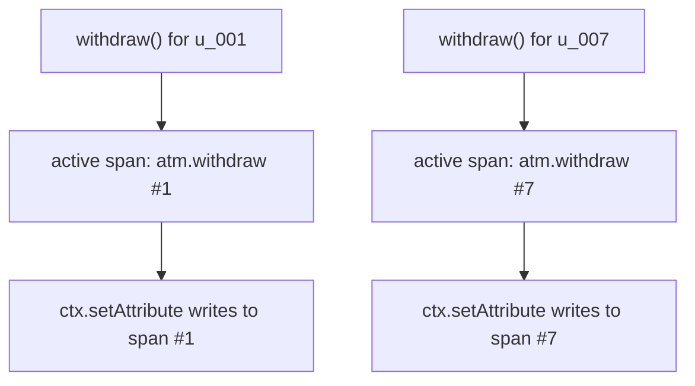
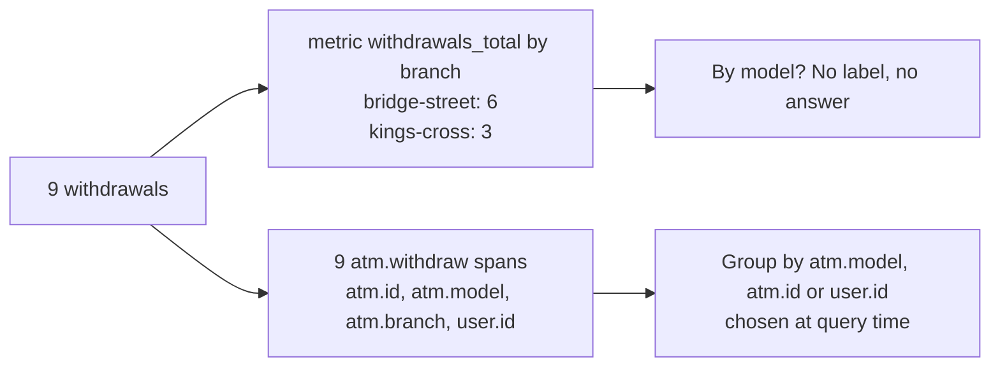

# Part 3: Attributes, not messages

## The scene

The bank runs three ATMs: two NCR-6622s and one Diebold-522, spread across two
branches. Support says some withdrawals feel slow and asks one
question:

> Is it one machine, one model, or one branch?

You have traces now. Each one is called `atm.withdraw`, and most take about
70ms. The facts that would answer support sit inside English log messages:

```ts
console.log(`withdrawal at ${machine.id} (${machine.model})`);
console.log(`customer ${user.name}`);
```

Devtools cannot search those strings, so every withdrawal looks the same.

```sh
pnpm ex 03
```

## Predict, before you run it

> `atm.model` takes two values across the estate. `withdrawal.transaction_id`
> is unique to every withdrawal ever made. Which of the two is more useful to
> record, and which one would a metrics system (a tool such as Prometheus that
keeps running counts) charge you for?

## Your turn

Move the facts out of the strings and onto the span as attributes. An
**attribute** is a named value attached to a span, such as
`atm.branch = "bridge-street"`. Devtools can filter and group on attributes. It
can do neither with a log message.

Then answer these three from the devtools search box, without opening the
source:

1. How many withdrawals happened at `bridge-street`?
2. Did any withdrawal take longer than 100ms, and on which machine?
3. What did user `u_007` do?

The exercise already imports `ctx` from `autotel`. Look at `ctx.setAttribute`
and `ctx.setAttributes`.

## Our solution

```sh
pnpm sol 03
```

```ts
ctx.setAttributes({
  'atm.id': machine.id,
  'atm.model': machine.model,
  'atm.branch': machine.branch,
  'withdrawal.amount_pence': amountPence,
});

const user = await findUserByCard(cardNumber);
ctx.setAttribute('user.id', user.id);
```

Further down, the solution adds `account.id`, `account.balance_pence` and
`withdrawal.transaction_id` the same way. Type these into the search box:

```
atm.branch = "bridge-street"
name = "atm.withdraw" and duration > 100
user.id = "u_007"
```

The first query returns six withdrawals. The second returns one, at
`atm_0431`, and it belongs to `u_007`, the customer the third query finds. That
withdrawal took about 350ms while the other eight took about 70ms. Hold that
thought until part 10.





### Why this solution

**`ctx` is ambient.** You reach it from anywhere inside the call without passing
it in, and unlike a global, each concurrent call sees its own value. It resolves
to whichever span is active at the point you call it, including several frames
deep inside a helper. Part 2's `AsyncLocalStorage` mechanism
provides it: each concurrent call to `withdraw` carries its own active span, so
nine calls running at once write to nine separate spans.



**A message is a string; an attribute is a column.** Picture the spans from this
run as rows in a spreadsheet, one row per withdrawal and one column per
attribute:

| span           | atm.id     | atm.model     | atm.branch      | user.id  | duration |
| -------------- | ---------- | ------------- | --------------- | -------- | -------- |
| `atm.withdraw` | `atm_0431` | `NCR-6622`    | `bridge-street` | `u_001`  | ~70ms    |
| `atm.withdraw` | `atm_0912` | `NCR-6622`    | `kings-cross`   | `u_002`  | ~70ms    |
| `atm.withdraw` | `atm_1180` | `Diebold-522` | `bridge-street` | `u_003`  | ~70ms    |
| ...            |            |               |                 |          |          |
| `atm.withdraw` | `atm_0431` | `NCR-6622`    | `bridge-street` | `u_007`  | ~350ms   |

`user.id = "u_007"` filters on one column, like a spreadsheet filter.
`'customer Ada Okafor'` needs a regular expression over English, and your
expression breaks the day a colleague rewords the message.
_Observability Engineering_ (Chapter 5) makes the same move with web-server
logs: once `user` is a field, "count unique users between two time periods"
becomes a `SELECT DISTINCT user` instead of a regular expression run over every
message.

**Record high-cardinality fields.** **Cardinality** is how many different
answers a field can have. Ask "which model?" and you get one of two answers.
Ask "which transaction?" and every withdrawal gives a new answer, millions over
a year. A decade of metrics billing taught engineers to fear the second kind,
and the book argues for it:

> High-cardinality data is the most descriptive and identifying type of data,
> and it is vital for observability. Think of all the most useful attributes you
> would like to search or group by: build number, commit hash, container ID,
> span ID, user ID, app name, query hash, etc. All of which are high cardinality,
> and that is why they're useful.

That passage comes from Chapter 1, which also names a second measure.
**Dimensionality** is how many fields one record carries: how many questions
the record can answer, where cardinality is how many answers one question has.
This part adds dimensions to `atm.withdraw`; part 5 shows why each new one
multiplies what you can ask.

The fear comes from how metrics work. A **metric** is a named number the system
keeps updating, such as `withdrawals_total`. Give it a `branch` label and the
system keeps a separate running number per branch: one for bridge-street, one
for kings-cross. Each of those running numbers, recorded minute by minute, is a
**time series**. Label the metric by `transaction_id` and the system starts a
new series for every withdrawal, and metrics tools store, and often bill, per
series. A trace backend stores the ID as one more field on one span and creates
no series at all.

**A metric decides the question before you ask it.** A metric works like a
tally counter at a door: it tells you six people came in, and never who they
were. Span attributes work like a pile of receipts you can re-sort any way you
like. Suppose you had counted withdrawals as a metric labelled by branch. The
metrics system adds the nine withdrawals into two numbers, six at bridge-street
and three at kings-cross, and discards the rows. Then support asks about the
model. The metric never had a model label, and no query can split a sum back
into the rows that made it. The book calls this "Pre-aggregation is a one-way
trip" (Chapter 1). Part 9 has you build a metric like this one, and shows the
jobs it does better than spans.



That answers the prediction: record both. `atm.model` sorts withdrawals into
two groups, `withdrawal.transaction_id` finds one withdrawal among millions, and
only the metrics system would charge you for the second. Keep IDs out of
attribute _names_, such as `latency.u_007`, where each new user creates a new
column.

**Follow a naming convention.** Name attributes in lowercase, dotted, and
namespaced by the thing they describe: `atm.id`, `user.id`,
`withdrawal.amount_pence`. OpenTelemetry publishes **semantic conventions**, a
shared dictionary of attribute names such as `http.request.method`,
`db.system.name` and `server.address`. Every tool that reads OpenTelemetry
agrees `http.request.method` holds the HTTP verb, so it can build views on it
without you configuring anything. Use those names where they fit. Invent names for
your own domain and keep them consistent: devtools cannot group `atm.id` from
one service with `atmId` from another.

Span names follow the same rule: name the operation, `atm.withdraw`, and move
the variable parts into attributes. A span called `withdraw u_007` gives each
customer their own name, so you can no longer group by name. The book's example
rewrites `GET /users/profile/349827487124` as
`GET /users/profile/{user.id}` (Chapter 7). Put the unit in the key, as
`withdrawal.amount_pence` does, and keep one unit per key. A field that holds
pence on one span and pounds on another corrupts every sum you take over it.

### What to record

Ask what you would need during an incident. These categories cover most of it:

| Category   | Examples                                                    |
| ---------- | ----------------------------------------------------------- |
| Who        | `user.id`, `account.id`, `tenant.id`                        |
| Where      | `atm.id`, `atm.branch`, `host.name`, `deployment.environment` |
| What       | `withdrawal.amount_pence`, `http.route`, `db.operation.name` |
| Outcome    | `withdrawal.result`, `error.type`, `http.response.status_code` |
| Which code | `service.version`, commit sha, feature flag values          |

`init()` attaches some of these for you as **resource attributes**, facts about
the process rather than the request. Open any span in devtools and you will find
`service.name` and `host.name` there. Add `service.version` and a commit sha
yourself when you deploy, so you can compare one release against the next.

Automatic instrumentation fills in the HTTP and database rows for you. It
cannot know that your bank has branches, so the attributes specific to your
application, which the book rates as the most valuable (Chapter 6), fall to
you.

Leave out what you would have to protect. The solution records `user.id` and
drops `user.name`: the ID finds the customer, and the name is personal data
that each tool storing your telemetry would then hold.

---

Previous: [Part 2: Your first span](../02-your-first-span/README.md) ·
Next: [Part 4: Which work deserves a span](../04-which-work-deserves-a-span/README.md)
