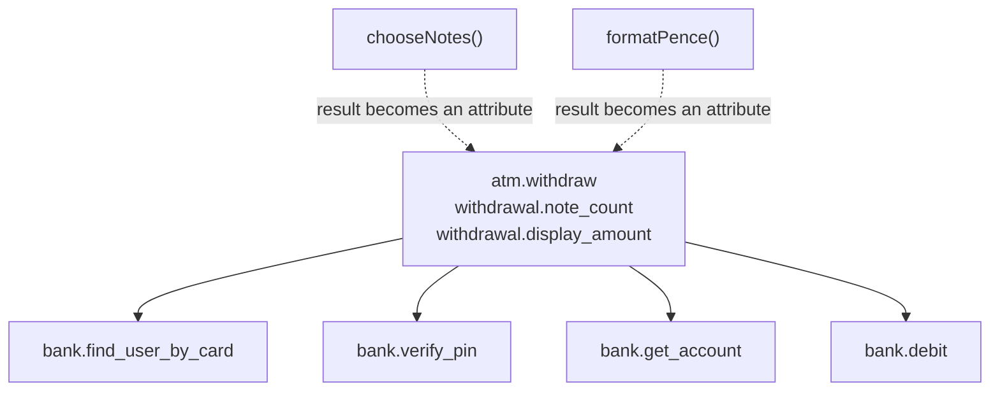
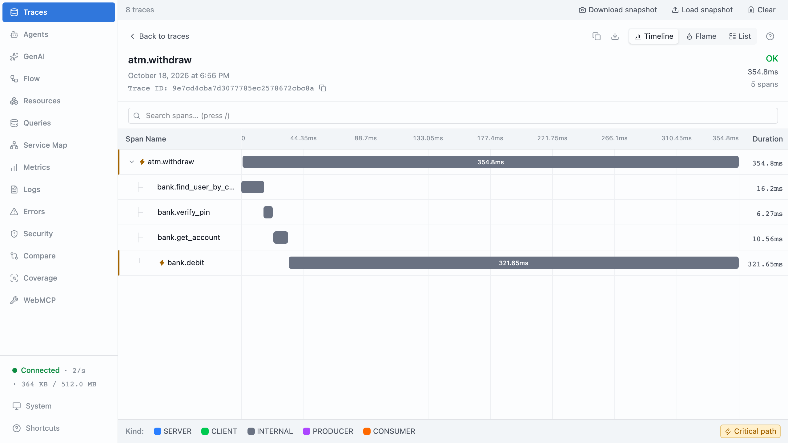

# Part 4: Which work deserves a span

## The scene

One withdrawal took about 350ms. Your trace holds one span, `atm.withdraw`,
lasting 350ms. The customer already told you it was slow, so the trace adds
nothing you did not know.

Six operations run inside that withdrawal. You could give each one its own
span, or none of them. You need a rule for choosing.

```sh
pnpm ex 04
```

## Predict, before you run it

For each of the six, answer yes or no before reading further:

| Operation                                                       | Span? |
| --------------------------------------------------------------- | ----- |
| `verifyPin`: checks the PIN, counts failures, can lock the card |       |
| `findUserByCard`: looks the customer up                         |       |
| `getAccount`: looks the account up                              |       |
| `debit`: moves the money                                        |       |
| `chooseNotes`: greedy arithmetic over four denominations        |       |
| `formatPence`: turns `4000` into `"£40.00"`                     |       |

## Your turn

Wrap the ones that earn it. `trace(name, fn)` takes a function and returns a
wrapped one, so you can instrument code you did not write without editing it:

```ts
const tracedDebit = trace('bank.debit', debit);
```

Call the wrapped version inside `withdraw`. It produces a **child span**: a
span whose parent is the span that was active when it started, here
`atm.withdraw`.

## Our solution

```sh
pnpm sol 04
```

The solution wraps four of the six:

```ts
const tracedVerifyPin = trace('bank.verify_pin', verifyPin);
const tracedFindUser = trace('bank.find_user_by_card', findUserByCard);
const tracedGetAccount = trace('bank.get_account', getAccount);
const tracedDebit = trace('bank.debit', debit);
```

`chooseNotes` and `formatPence` get no span. Their results land on
`atm.withdraw` as attributes instead:



Open a trace in devtools and you see a **waterfall**: each span drawn as a
horizontal bar, placed by its start time and sized by its duration, with
children indented under their parent. Compare a typical withdrawal with the
`u_007` one:

```mermaid
gantt
  title Two withdrawals from the same run (ms)
  dateFormat x
  axisFormat %L
  section Typical
  bank.find_user_by_card :0, 15
  bank.verify_pin        :15, 20
  bank.get_account       :20, 30
  bank.debit             :30, 70
  section Slow
  bank.find_user_by_card :0, 15
  bank.verify_pin        :15, 20
  bank.get_account       :20, 30
  bank.debit             :crit, 30, 350
```



The slow withdrawal spends 320 of its 350ms inside `bank.debit`. With one span
you had a total. With five you can point at the step that ate the time.



### Why this solution

_Observability Engineering_ (Chapter 7) gives two questions that guide the
choice:

> 1. Is it "interesting"? Does the work meaningfully impact performance (e.g.,
>    latency or failures) for the overall request?
> 2. Is it "aggregable"? If you group this span by name and/or attributes, will
>    it produce useful trends and comparisons?

In plain terms: does this step change how long a withdrawal takes or whether it
succeeds? And would you ever compare this step across many withdrawals, such as
the average `bank.debit` time per branch? Run the six through them:

| Operation        | Interesting?                            | Aggregable?                            | Span    |
| ---------------- | --------------------------------------- | -------------------------------------- | ------- |
| `verifyPin`      | Yes: can fail, and failure locks a card | Yes: group by outcome                  | **Yes** |
| `findUserByCard` | Yes: a lookup that can miss             | Yes: group by hit or miss              | **Yes** |
| `getAccount`     | Yes: a lookup with variable latency     | Yes: group by account attributes       | **Yes** |
| `debit`          | Yes: moves the money, and can be slow   | Yes: group by account, amount, outcome | **Yes** |
| `chooseNotes`    | No: sub-millisecond, deterministic      | No: nothing to group by                | No      |
| `formatPence`    | No: it is a `toFixed` call              | No                                     | No      |

`atm.withdraw` passes for a different reason. The book separates orchestration
code, a function that only calls other functions in order and takes as long as
they do, from a business transaction with an outcome of its own. The first
earns no span; the second does. A withdrawal ends
dispensed or refused, and you will group by that outcome.

**Too many spans cost storage and attention.** A trace with a hundred
two-millisecond spans buries the boundaries you care about among implementation
details:

> If your trace has a hundred two-millisecond spans, you probably have too many.
> Roll them up: combine them into a single span, or represent the details as an
> attribute.

To find which function inside a step burns the time, the book points you to a
profiler, a tool that samples which function the CPU is running, rather than
more spans.

The solution takes the second option for `chooseNotes` and `formatPence`. You
keep their results without timing them:

```ts
ctx.setAttributes({
  'withdrawal.note_count': notes.length,
  'withdrawal.display_amount': formatPence(amountPence),
});
```

When a fact is worth recording but the work behind it is not worth timing, put
the fact on the span that already exists.

**Too few spans leave you with the 350ms you cannot explain**, the problem you
started this part with. You fix the two failure modes in opposite directions.

**A span explains one request; an attribute explains all of them.** The
waterfall shows where one withdrawal spent its time. Ask "which branch has the
slowest debits?" and you have to join two records: `atm.branch` lives on
`atm.withdraw` and the duration lives on `bank.debit`, so for each debit you
look up its parent to find the branch, then match the two. The book names
wrapping everything in its own span as the most common failure mode among
engineers new to tracing (Chapter 6). Its fix is to copy a few key timings,
such as a `debit.duration_ms`, onto the parent as attributes, so one record
answers the question. Part 5 builds that parent record.

### Automatic nesting

You never told `bank.debit` that `atm.withdraw` is its parent. When a span
starts, it reads the active span from the context, the per-call record from
part 2, and stores that span's ID as its parent ID. Part 2 introduced the mechanism. Part 11 shows it
breaking when the call crosses a network.

### Which functions to wrap in your own code

Wrap the places where your process hands work to something else and waits: an
outgoing HTTP call, a database query, a cache lookup, a queue publish or
consume. Wrap each incoming request handler too. Then add a span for the
business operation that names the request's purpose, such as `atm.withdraw` or
`refund.issue`. You will group by that name when someone asks how the product is
doing.

In a real service, OpenTelemetry's automatic instrumentation, packages that wrap
libraries such as `http` and database drivers, creates those spans for you, and
it errs toward too many. Review what it
produces and switch off the spans you never query. Spend your own spans on the
business operations it cannot see.

Draw span boundaries around components and services, even where they cross team
ownership, as _Observability Engineering_ recommends. An incident follows the
calls your code makes, and those ignore your organisation chart.

---

Previous: [Part 3: Attributes, not messages](../03-attributes-not-messages/README.md) ·
Next: [Part 5: One wide event per request](../05-one-wide-event/README.md)
