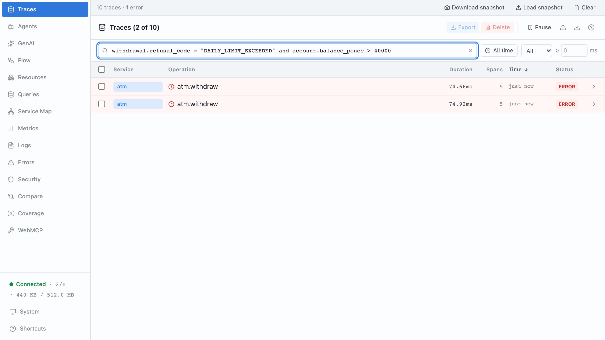
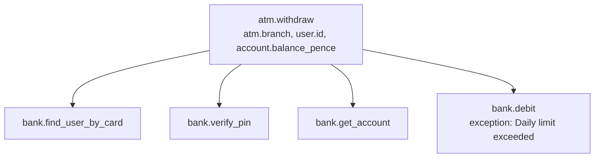
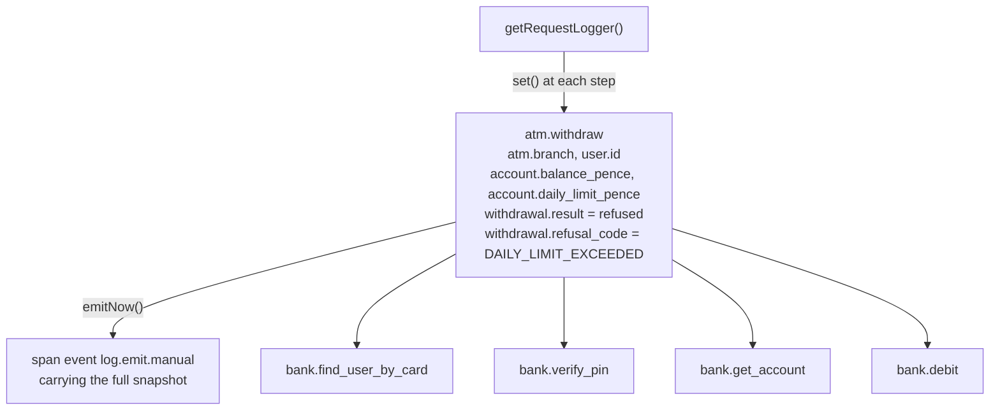
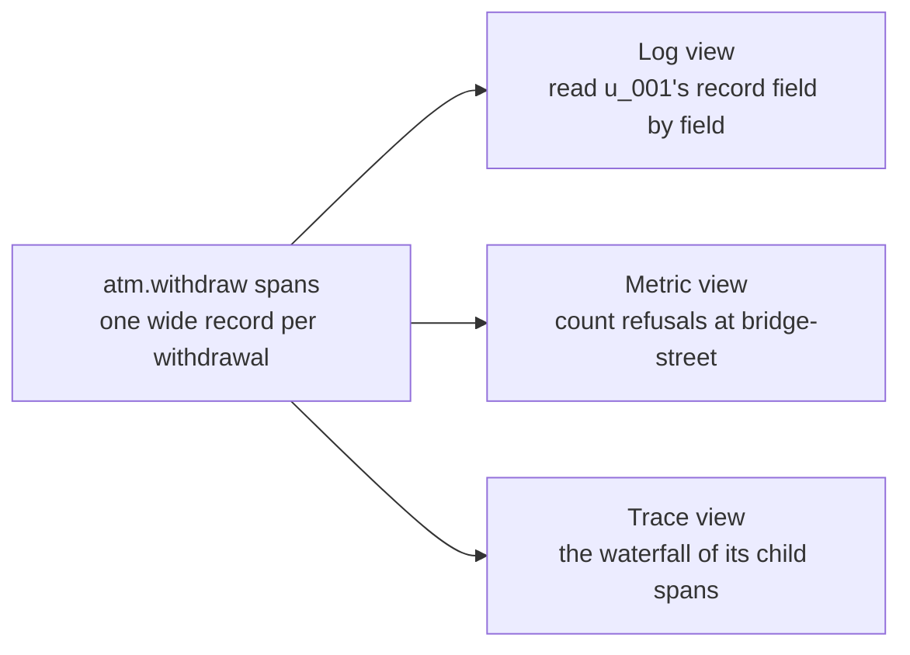

# Part 5: One wide event per request

## The scene

The machines refused two withdrawals this morning on the daily limit. Your
manager asks a reasonable question:

> Were those customers out of money, or did they have plenty and hit the £300
> cap?

You have the facts, scattered. The branch, the user and the balance sit on
`atm.withdraw` as separate attributes. The refusal code lives inside the
exception that the `bank.debit` child span threw, as the message "Daily limit
exceeded". No span carries the code as a field you can filter on, and a
successful withdrawal records no outcome at all. To answer, you open each
refused trace and read across its spans, one customer at a time.

```sh
pnpm ex 05
```

## Predict, before you run it

> Every fact about a refused withdrawal already sits somewhere on its five
> spans. What do you gain by gathering them onto the root span as one record?

## Your turn

Gather everything the withdrawal knew onto one record: who, where, how much,
the balance, the outcome, and the refusal code when there is one. Emit the
record on the success path and on the failure path, with the same field names
on both.

`getRequestLogger()` is in `autotel`.

## Our solution

```sh
pnpm sol 05
```

```ts
const log = getRequestLogger();
log.set({ atm: { branch }, withdrawal: { amount_pence: amountPence } });

try {
  // ...
  log.set({ user: { id: user.id } });
  log.set({
    account: {
      id: account.id,
      balance_pence: account.balancePence,
      withdrawn_today_pence: account.withdrawnTodayPence,
      daily_limit_pence: account.dailyLimitPence,
    },
  });
  log.set({
    withdrawal: { result: 'dispensed', transaction_id: receipt.transactionId },
  });
} catch (error) {
  log.set({
    withdrawal: {
      result: 'refused',
      refusal_code: isBankError(error) ? error.code : 'UNEXPECTED',
    },
  });
  throw error;
} finally {
  log.emitNow();
}
```

The manager's question becomes one filter:

```
withdrawal.refusal_code = "DAILY_LIMIT_EXCEEDED" and account.balance_pence > 40000
```

Both refused customers come back. `u_001` had £428.30 in the account and `u_004`
had £794.79 when the machine refused them. They had the money, and the £300 cap
stopped them. You have a product decision to revisit, and no outage.



In the exercise, each fact sits on whichever span learned it:



In the solution, the request logger gathers them all onto the root span:



### Why this solution

**The request logger writes onto the root span.** The root span is the top span
of the trace, here `atm.withdraw`. `getRequestLogger()` reads the active span,
so you pass nothing around. Each `.set()`
flattens nested objects into dotted keys, so `{ account: { balance_pence } }`
becomes `account.balance_pence` and matches the naming from part 3. It writes
those keys onto `atm.withdraw` as attributes as soon as you call it.
`.emitNow()` seals the logger. It adds one **span event**, a timestamped note
pinned to a span, named `log.emit.manual` and carrying the whole snapshot. Any
later `.set()` gets dropped with a warning.

You get no sixth span. The root span becomes the **wide event**: one record per
unit of work, holding everything that unit knew. Think of a till receipt. One
slip lists the shop, the time, each item and the total, so you can answer any
question about the purchase from that slip. The exercise gave you five sticky
notes instead, one fact on each, and you had to find and line them up first.

Written out as data, the root span of `u_001`'s refused withdrawal holds:

```json
{
  "name": "atm.withdraw",
  "service.name": "atm",
  "atm.branch": "bridge-street",
  "user.id": "u_001",
  "withdrawal.amount_pence": 25000,
  "account.id": "acc_001",
  "account.balance_pence": 42830,
  "account.withdrawn_today_pence": 10000,
  "account.daily_limit_pence": 30000,
  "withdrawal.result": "refused",
  "withdrawal.refusal_code": "DAILY_LIMIT_EXCEEDED"
}
```

That answers the prediction. The refusal code moves out of an exception message
on a child span and into a field on the root, next to the branch and the
balance, so one filter can combine facts that used to live on different spans.
Every field is flat, so the record reads like one row of the spreadsheet from
part 3, with more columns.

**Use `finally` to cover both outcomes.** The solution emits on the success and
failure paths with the same field names. Teams that emit a different shape on
the error path end up able to count their successes and unable to count their
failures.

**This shape has a name: the canonical log line.** A **canonical log line** is
one wide, structured event per unit of work, written once at the end. The book
stores all telemetry this way. "Three pillars" in its quotes means keeping logs,
metrics and traces in three separate tools, the model it argues against
(Chapter 1):

> All the telemetry that describes a request is stored once, preserving as much
> context and many relationships as possible, either in arbitrarily wide,
> structured log events, called "canonical logs," or as spans and traces.

Part 3 defined cardinality, how many answers one field has. The argument for
wide events turns on **dimensionality**, how many fields one record carries.
Each question you ask looks at some fields together. Take four fields from the
withdrawal: branch, user, balance and refusal code. You can ask about one field
alone (4 ways), a pair such as branch with refusal code (6 ways), any three (4
ways) or all four (1 way): 15 questions. The shortcut is that each field is
either in your question or out of it. That gives 2 × 2 × 2 × 2 = 16 choices,
minus the empty one. Each new field doubles the count, which is why the book's
numbers climb so fast (Chapter 1):

> If a structured log has four dimensions or attributes, you can combine them in
> 15 possible ways. The math escalates quickly:
>
> 4 fields → 6 pairwise combos, 15 possible combinations
> 8 fields → 28 pairwise combos, 255 possible combinations
> 30 fields → 435 pairwise combos, 1.1 billion possible combinations
>
> This is why the three pillars model is so costly. When you scatter signals
> across siloed tools by type, you don't just lose some of the value; you lose
> most of it.

Now split thirty fields across five spans, six on each. Each span supports
2⁶ − 1 = 63 combinations, 315 across the five, where one record with all thirty
supports about a billion. You keep every field and lose every question that
needs two fields from different spans, such as refusal code with balance.

Your manager's question combines two fields: refusal code and balance. You
never wrote that query in advance, because you did not know anyone would ask
it. Test your instrumentation against the questions you expect, then add
context as investigations reveal gaps.

### One record, many views

Logs, metrics and traces look like three kinds of data. Chapter 5 of the book
takes them apart and finds one shape underneath: a structured event, a set of
key-value pairs describing a unit of work. The wide `atm.withdraw` span is that
shape, so you can read it three ways:



The metric view changes how you work. A metrics system makes
you choose the aggregate before you collect anything. With wide events you
choose it afterwards: count the matches for
`withdrawal.result = "refused" and atm.branch = "bridge-street"` and you have a
refusal count per branch that nobody defined in advance. The book's phrase is
to capture the facts and "post-decide the necessary shape" (Chapter 5).

### What else belongs on the wide event

The solution's record holds about ten fields. The book's contributor finds
hundreds on a well-instrumented service (Chapter 6). Two additions pay off
early:

- **Timings of key steps.** A `debit.duration_ms` field on the root lets you
  ask which branch has the slowest debits without joining two spans, the
  problem part 4 left open.
- **Deploy and runtime context.** `service.version` and any feature flag the
  request touched let you compare one release, or one flag value, against
  another.

Count on the root span only. A child span can carry a field with the same name,
and a query over every span would count it twice. The book tags wide events
with `main = true` for this reason. Here the root span's name,
`atm.withdraw`, does the same job.

### When to use which

You now have three complementary ways to record a fact:

|                                         | Reach for it when                                                                   |
| --------------------------------------- | ----------------------------------------------------------------------------------- |
| **Span** (`trace`)                      | Work that takes time and can fail. It answers _how long_ and _what ran inside what_ |
| **Attribute** (`ctx.setAttribute`)      | A fact about one piece of that work                                                 |
| **Request logger** (`getRequestLogger`) | Everything the whole unit of work knew, gathered onto the root span as one record  |

Treat the request logger as a discipline: gather as you go, emit once, and keep
the same shape on each path.

**Keep secrets out of it.** You want to hand a wide event to anyone debugging,
so leave out PINs, card numbers, tokens and full names.
`init({ attributeRedactor: 'default' })` gives you a backstop, and data you
never record cannot leak through telemetry.

---

Previous: [Part 4: Which work deserves a span](../04-which-work-deserves-a-span/README.md) ·
Next: [Part 6: Logs you already have](../06-logs-you-already-have/README.md)
