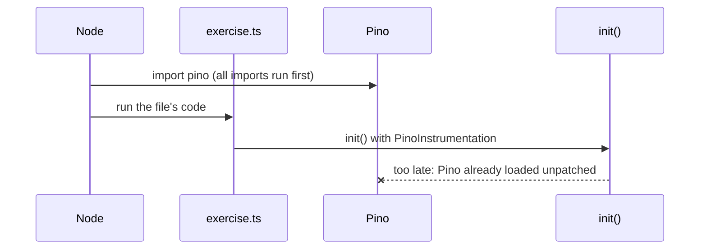
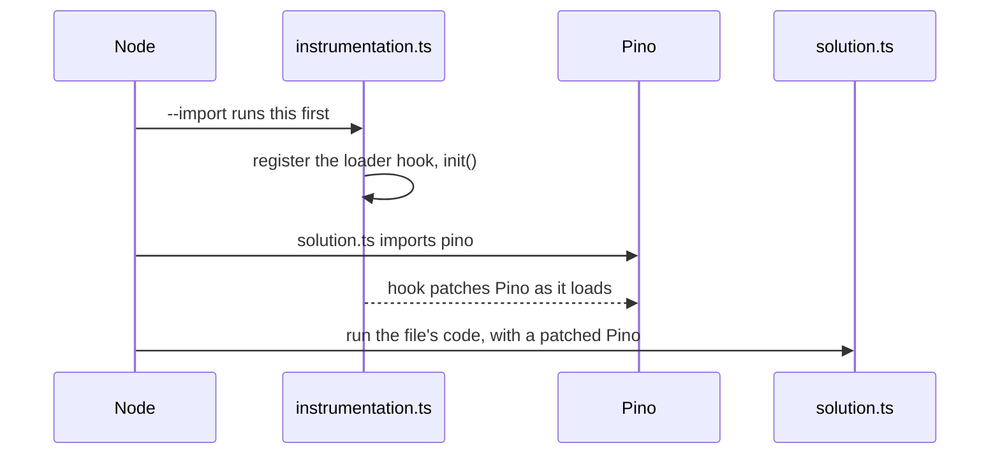

# Part 6: Logs you already have

## The scene

Part 5 gave each withdrawal one wide record. Your team likes it. Then someone
points at the rest of the codebase: four hundred `logger.info` calls, written
with [Pino](https://getpino.io) over three years, feeding a log search the
support team uses every day.

Nobody is going to delete them. You want each of those lines to say which
withdrawal wrote it, so a support agent who finds `pin ok` in the log search
can jump to that withdrawal's trace.

Part 1 left you in the same place with `console.log`: five withdrawals writing
into one stream, and no field saying whose line is whose.

```sh
pnpm ex 06
```

## Predict, before you run it

> The exercise turns on the Pino instrumentation in the first statement of the
> file, before any withdrawal runs. The log lines still carry no trace id. What
> did `init()` arrive too late for?

## Your turn

Make every Pino line carry the `trace_id` and `span_id` of the withdrawal that
wrote it. Do not add either field by hand: the logger calls stay as they are.

Two hints. `autotel/register` exists. And `pnpm ex` honours a line near the top
of the file that reads `// import: ./instrumentation.ts`.

## What you get

```
{"level":30,"time":…,"amountPence":2000,"msg":"withdrawal started"}
{"level":30,"time":…,"amountPence":4000,"msg":"withdrawal started"}
{"level":30,"time":…,"amountPence":6000,"msg":"withdrawal started"}
```

The structure from part 1 is there: JSON, named fields. The identity is not.
Five withdrawals still share one stream, and nothing ties a line to the trace
you built in parts 2 to 5.

## Our solution

```sh
pnpm sol 06
```

Move the setup into its own file:

```ts
// instrumentation.ts
import 'autotel/register';
import { init } from 'autotel';
import { PinoInstrumentation } from '@opentelemetry/instrumentation-pino';

init({
  service: 'atm',
  devtools: true,
  instrumentations: [new PinoInstrumentation()],
});
```

Then load it before the app. The solution's first line asks for that:

```ts
// import: ./instrumentation.ts
```

`pnpm sol 06` turns that line into
`tsx --import ./src/06-logs-you-already-have/instrumentation.ts solution.ts`.
The logger calls in `solution.ts` did not change, and each line now carries
three new fields:

```
{"level":30,…,"trace_id":"da8ba6d24cd7d40cd21a4688ca1a82a9","span_id":"23bb55909060caff","trace_flags":"01","amountPence":2000,"msg":"withdrawal started"}
```

Your ids will differ. Copy one `trace_id` into the devtools search box as
`trace_id = "…"` and you land on that withdrawal's trace.

### Why this solution

**Instrumentation works by patching a library as it loads.** An
_instrumentation_ for a library is code that wraps some of its functions. The
Pino instrumentation wraps the function Pino calls to write a line. Before the
line goes out, the wrapper reads the active span, the same per-withdrawal
record from part 2, and adds its `trace_id` and `span_id`. The patch has to be
in place when Pino loads. A copy of Pino loaded earlier stays unpatched.

**The first statement in a file does not run first.** JavaScript runs every
`import` in a file before the file's own code, whatever order you wrote them
in. So in the exercise, Pino had loaded, unpatched, before `init()` ran on
"line one":



The fix is to start a separate file first. `--import` tells Node to load
`instrumentation.ts`, and finish it, before it touches `solution.ts`:



**`autotel/register` installs the hook.** Your code uses ES modules (`import`
rather than `require`). Node loads ES modules through a loader, and a library
can only be patched on the way in if a _loader hook_ sits in that path. The
`import 'autotel/register'` line installs one, so it must come before
anything you want patched.

**This is the most common "nothing shows up" bug at work.** Automatic
instrumentation for `http`, Express, Postgres and Pino all works this way. If
`init()` runs after the app's imports, you get your own spans from `trace()`
and nothing from the libraries, with no error to say so. The cure is the same
in every Node service: one setup file, loaded with
`node --import ./instrumentation.js app.js`.

### Two things the instrumentation does

1. **It stamps the ids into each line.** Your log search, whichever you use,
   now has a `trace_id` field on every line. People call this _log
   correlation_: logs and traces can be matched by id.
2. **It sends each line to devtools as a log record.** OpenTelemetry carries
   three kinds of data, called _signals_: traces, metrics and logs. You have
   used traces since part 2, and part 9 covers metrics. The instrumentation
   copies each Pino line into a log record, with its trace id, and the
   exporter sends it alongside your spans. `pnpm check` confirms that a `pin ok` record arrives
   linked to a trace.

The book describes where this leads. In Chapter 5, the authors picture a set
of events that all share the same ID, which is what a trace is. With the id on
every line, your logs become more events in that set rather than a separate
pile.

### Where log lines fit next to the wide event

You now have two kinds of record per withdrawal, joined by `trace_id`:

| Record                | How many per withdrawal | Good for                                                    |
| --------------------- | ----------------------- | ----------------------------------------------------------- |
| Wide event (part 5)   | One                     | Filtering and grouping: "refused at bridge-street, over £400" |
| Log lines (this part) | One per step            | Reading the story of one withdrawal in order                 |

Keep writing log lines for the steps a person reads while debugging. Put the
facts you will filter or group on into the wide event, so a question never
needs you to search free text. The trace id means you can move between the
two.

### Using Winston instead

The pattern is identical: `@opentelemetry/instrumentation-winston` in place of
the Pino one, loaded the same way. Every popular Node logger has an
instrumentation, because OpenTelemetry aims to work alongside your logger
rather than replace it.

---

Previous: [Part 5: One wide event per request](../05-one-wide-event/README.md) ·
Next: [Part 7: Errors that explain themselves](../07-errors-that-explain-themselves/README.md)
