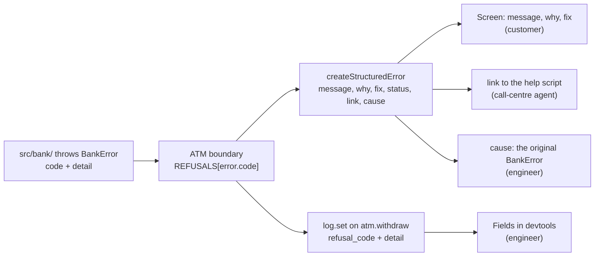
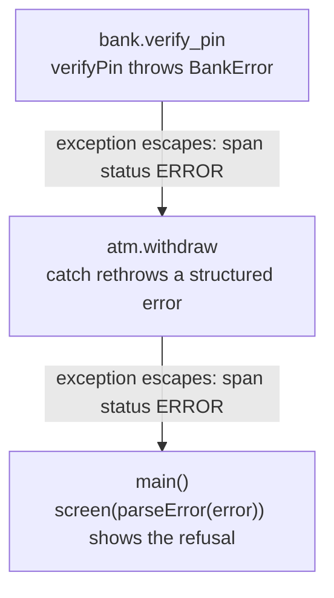
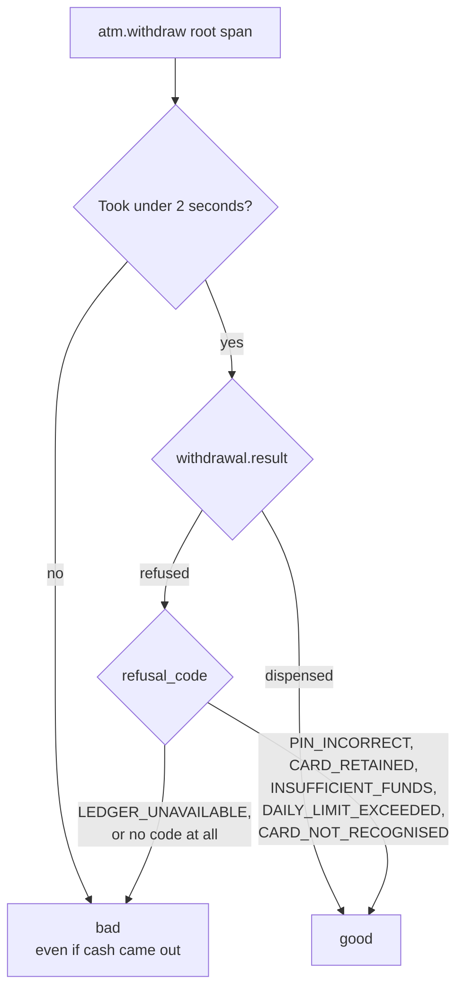

# Part 7: Errors that explain themselves

## The scene

Last month the call centre took 400 calls that all began the same way:

> The machine said "Transaction failed, contact your bank." What does that mean?

That one sentence hides five conditions: an unrecognised card, a wrong PIN, a
retained card, an empty account, and a daily cap that resets at midnight. If the
machine named the condition, customers could sort out four of them without
picking up the phone.

```sh
pnpm ex 07
```

The exercise runs six withdrawals. One uses an unknown card. Three use the same
card with the wrong PIN. One asks for more than the balance, and one asks for
£400 against a £300 daily limit. All six end on the same screen.

## Predict, before you run it

> The refusal has to be understood by three audiences: the customer at the
> machine, the agent taking the call, and the engineer on call at 3am. Does that
> take three error types, or one?

## Your turn

Make each refusal say what happened, why, and what to do next. You have two
constraints, and they are the interesting part:

- The screen sits in a public place. Nothing on it may help someone standing
  behind the customer.
- The engineer on call needs more than the screen shows, and should not have to
  read this file to get it.

`createStructuredError` and `parseError` are in `autotel`. A **structured
error** is an `Error` that carries named fields (`why`, `fix`, `status`, `link`)
next to its message, so code can read each part on its own. `parseError` reads
those fields back out of any thrown value.

## Our solution

```sh
pnpm sol 07
```

The solution has three pieces: a table, a translation, and a reader.



**The table.** `REFUSALS` holds one row per `BankErrorCode`. The run produces
five of the six codes. `src/bank/` never throws `LEDGER_UNAVAILABLE` yet, but
the table's type, `Record<BankErrorCode, ...>`, makes TypeScript demand a row
for every code.

```ts
DAILY_LIMIT_EXCEEDED: {
  message: 'Daily limit reached',
  why: 'This amount would take today’s total past the £300 daily cash limit.',
  fix: 'The limit resets at midnight. Larger amounts can be arranged in branch.',
  status: 429,
  link: 'https://bank.example/help/daily-limit',
},
```

**The translation**, in one place, at the boundary:

```ts
} catch (error) {
  if (!isBankError(error)) throw error;

  const refusal = REFUSALS[error.code];
  log.set({
    withdrawal: { result: 'refused', refusal_code: error.code },
    ...error.detail,
  });

  throw createStructuredError({
    ...refusal,
    code: error.code,
    cause: error,
  });
} finally {
  log.emitNow();
}
```

**The reader**, which is the same code any client would write:

```ts
const parsed = parseError(error);
// parsed.message, parsed.why, parsed.fix, parsed.status, parsed.link
```

### Why this solution

**One error type can serve three audiences.** Each field has a reader:

| Field     | Read by                                                                  |
| --------- | ------------------------------------------------------------------------ |
| `message` | The customer. One line, on a screen, in public                           |
| `why`     | The customer and the agent. What the machine believes happened           |
| `fix`     | The customer. The next step they can take themselves                     |
| `status`  | The caller's code. `402` and `429` take different branches; both "failed" |
| `link`    | The agent. The page with the script for this refusal                     |
| `cause`   | The engineer. The original `BankError`, kept intact                      |

`cause` is the standard `Error.cause` property: the error that led to this one.
Keeping the original `BankError` there means the engineer can still see its
`code` and `detail` after the ATM has rewritten the message for the customer.

The status codes borrow HTTP meanings so a caller can branch on a number it
already understands. `402 Payment Required` marks insufficient funds.
`423 Locked` marks a retained card. `429 Too Many Requests` marks the daily
limit, because the customer has asked for too much today. `503` marks a ledger
that did not answer, which is the one refusal caused by the bank's own systems.

**You put the translation at the boundary.** `src/bank/` still throws its own
`BankError` and knows nothing of screens, call centres or help pages. The ATM
knows all three, so the mapping lives in the ATM, in one table a product manager
can read and edit.

**The screen and the telemetry get different facts.** The screen never shows
the balance, the PIN attempts left, or the card that went in. The event on the
span does, because `...error.detail` spreads the domain's own numbers onto it.
The third wrong PIN and the daily-limit refusal leave these fields:

```
auth.attempts = 3
auth.attempts_remaining = 0
account.daily_limit_pence = 30000
account.withdrawn_today_pence = 0
```

The daily-limit customer had withdrawn nothing today, so the £400 request broke
the limit on its own. The fields tell you that without a phone call.

**Keep secrets out of telemetry.** Attempt counts and limits help an
investigation; PINs, full card numbers and names never go in a field. Part 5's
`attributeRedactor` backstop still applies.

### Refusals and the ERROR status

Every span carries a **status**: `UNSET` by default, `OK`, or `ERROR`. Tracing
tools count `ERROR` spans to draw an error-rate chart and to fire **alerts**:
automatic messages that tell a person something is wrong. An urgent alert
**pages** someone, which means it rings their phone, day or night. The person
holding that phone this week is **on call**.

The `trace()` wrapper sets `ERROR` on a span when an exception escapes the
function it wraps. It also records the exception message on the span, so you
never write `span.recordException` yourself. In this part that rule fires on
every refusal, twice:



That is a trade-off, and you should make it on purpose. A wrong PIN or a daily
limit is an expected business outcome: the system did its job and said no. HTTP
draws the same line with its status codes. A `4xx` code means the caller got
something wrong, such as a mistyped URL. A `5xx` code means the server broke.
OpenTelemetry marks a server span `ERROR` only for `5xx`. If you build an
error-rate alert on `status = ERROR` against this code, your on-call engineer
gets woken up when a customer mistypes a PIN.

A count of `ERROR` spans has a second problem. The diagram shows one refusal
marking two spans, so a raw count reports two errors for one withdrawal.
Chapter 6 of _Observability Engineering_ computes error rates over the root span
of each request only, for the same reason. Here that means `atm.withdraw`.

### Which refusals deserve a page

Chapter 11 sets two tests for an alert worth waking someone for. It must be a
reliable sign that users are having a worse time, and the person woken must be
able to do something about it. A wrong PIN fails the first test. The customer
got a correct answer in about 20ms, and nobody can fix their memory.

The book's tool for this is the **service level objective** (SLO). You can
build one in four steps.

**1. Decide what a good withdrawal is,** in words a customer would agree with:
"the customer got a correct answer within two seconds". A refusal for a wrong
PIN is a correct answer. A ledger that never replied is not.

**2. Turn that sentence into a rule.** The rule is the **service level
indicator** (SLI). It looks at each `atm.withdraw` span and gives a verdict:



The slow branch matters. The Bridge Street customer from part 1 got their £40
after eleven seconds, and the SLI still counts that withdrawal as bad. Chapter
11 makes the same call for a web page: a response over the time limit counts as
an error even when it returned a success code.

**3. Count, and pick a target.** Over the last 30 days, divide good withdrawals
by all withdrawals. If the estate handled 300,000 and 299,700 were good, you
scored 99.9%. The SLO is the score you promise to stay above, say 99.9%.

**4. Treat the gap as a budget.** A 99.9% target over 300,000 withdrawals
allows 300 bad ones a month. That allowance is the **error budget**. Think of a
phone plan with 30 GB of data a month: using it is fine, and the plan only
fails you when it runs out before the month ends.

The alert watches the **burn rate**: how fast you spend the budget compared with
the steady pace that would last the full 30 days. Here the steady pace is 10 bad
withdrawals a day. Chapter 12 describes a ladder of responses:

- **About 1x,** spending at the steady pace: nothing to do.
- **About 2x for a sustained stretch,** or a slow leak that puts you on course
  for 99.88% by the end of the month: an alert that waits for working hours.
- **Four times the pace or faster:** a page, now.

Five wrong PINs cost nothing, because they count as good. Now take a ledger
outage. The estate handles about 830 withdrawals every two hours, and the
outage fails 200 of them. That spends two thirds of the month's budget in two
hours, 240 times the steady pace, since the steady pace allows under one bad
withdrawal in that time. That pages someone, because customers felt it and an
engineer can act on it.

The SLO tells you *what* is wrong, customers getting bad answers, and says
nothing about *why*. Chapter 11 calls that the point. Older alerts watch a
possible cause, such as "CPU above 80% for five minutes", and fire whether or
not any customer noticed. Teams learn to ignore alerts that cry wolf, which the
book calls **alert fatigue**. An SLO alert fires on the symptom customers feel,
and the investigation in part 10 finds the cause.

### Expected errors and unexpected ones

Chapter 6 suggests two error fields. An `exception.expected` flag separates
failures you cannot prevent (a wrong PIN) from real faults. An `exception.slug`
gives each place that throws a short fixed label you can group by and search
the code for. `withdrawal.refusal_code` already does the slug's job:
`DAILY_LIMIT_EXCEEDED` names one throw site in `src/bank/ledger.ts`. An
`expected` column in `REFUSALS` would add the flag: true for five codes, false
for `LEDGER_UNAVAILABLE`.

The book adds one query worth running: failures with no label. Here that means
an `atm.withdraw` span with status `ERROR` and no `withdrawal.refusal_code`. An
error that is not a `BankError` skips the table and lands in that group. Each
one is a failure nobody anticipated. Parts 8 and 10 label those `UNEXPECTED` so
you can query them by name.

To keep refusals out of the span error rate, catch them inside the span and
return a result instead of throwing. This workshop keeps the throw so you can
see the wrapper's behaviour.

### Try it

```
withdrawal.result = "refused"
status = ERROR
withdrawal.refusal_code = "CARD_RETAINED"
```

The last query is worth a moment. Three withdrawals used one card with the same
wrong PIN, and the third had a different ending from the first two. The counter
behind that lives in `bank/auth.ts` and survives between requests. State that
outlives a request makes an incident confusing, and `auth.attempts = 3` on the
span is the field that tells you the earlier requests happened.

---

Previous: [Part 6: Logs you already have](../06-logs-you-already-have/README.md) ·
Next: [Part 8: The questions the business asks](../08-events-the-business-asks-for/README.md)
