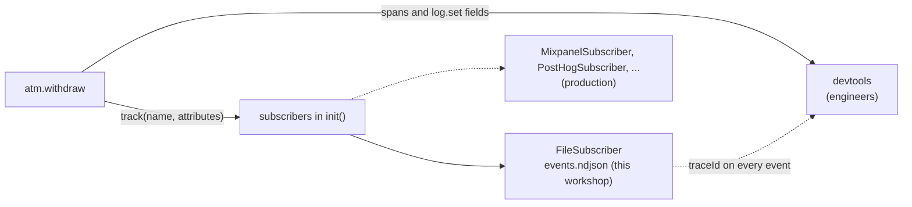
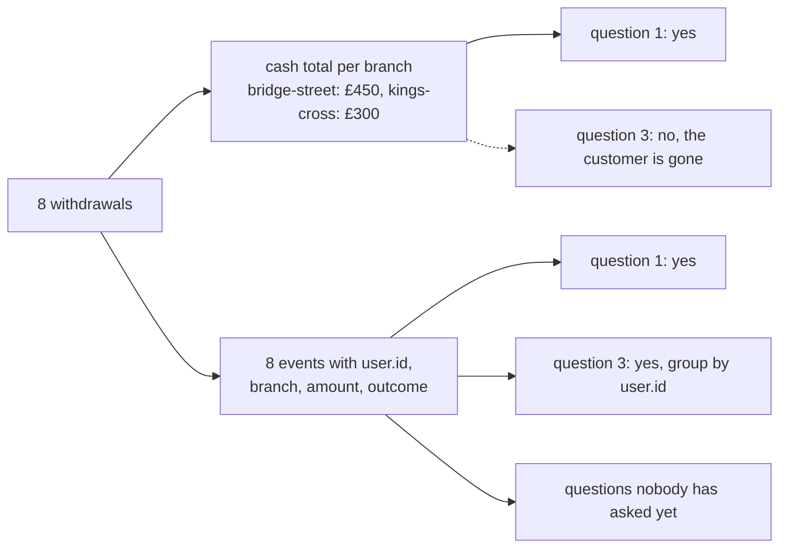

# Part 8: The questions the business asks

## The scene

Three questions arrived this week, and no engineer asked any of them.

1. How much cash left the estate at bridge-street yesterday?
2. Of the customers we refused on the daily limit, how many had enough money?
3. When we refuse someone, do they come back and try a smaller amount?

Part 5 answered question 2 with one filter. Questions 1 and 3 are about what
customers did. The product team asks them every week, and the person asking
should not need a login to your tracing tool to get an answer.

```sh
pnpm ex 08
```

The exercise runs six withdrawals of £100, alternating bridge-street and
kings-cross. Then customer `u_001` comes back to bridge-street, asks for £250,
gets refused on the daily limit, and asks again for £150.

## Predict, before you run it

> Your spans already contain the amount, the branch and the outcome of every
> withdrawal. So what is left for a separate event to do?

## Your turn

Emit a business event for each completed and each refused withdrawal, and send
it somewhere a product team could read without asking you.

A **business event** records something that happened in the world ("cash
withdrawn", "withdrawal refused") in the terms a product team uses. `track()` in
`autotel` emits one. A **subscriber** is a destination for those events: a
file, a webhook, or an analytics tool such as Mixpanel. You list subscribers in
`init()`, and every `track()` call goes to each of them.

## Our solution

```sh
pnpm sol 08
```

```ts
init({
  service: 'atm',
  devtools: true,
  subscribers: [new FileSubscriber({ path: EVENTS_FILE })],
});

track('atm.cash_withdrawn', {
  'user.id': user.id,
  'atm.branch': branch,
  'withdrawal.amount_pence': amountPence,
  'account.balance_after_pence': receipt.balancePence,
});

track('atm.withdrawal_refused', {
  ...(userId && { 'user.id': userId }),
  'atm.branch': branch,
  'withdrawal.amount_pence': amountPence,
  'withdrawal.refusal_code': code,
});
```

Open `events.ndjson`, one JSON object per line. The run writes eight events,
and the last two answer question 3 without any help from you:

```
atm.withdrawal_refused       £ 250.00  trace 1f19518e88fe
atm.cash_withdrawn           £ 150.00  trace 8235552fbf31
```

Your trace ids will differ. `u_001` asked for too much, got refused, and came
back for less. Both events carry `user.id`, so the product team can count that
pattern even with thousands of other events in between. The solution declares
`userId` outside the `try` so the refusal event can use it; an unknown card has
no user, and the spread leaves the field off.

Question 1 comes out of the same file. Sum `withdrawal.amount_pence` over the
`atm.cash_withdrawn` events at bridge-street: three withdrawals of £100 plus the
£150 retry, £450 in total.

### Why this solution

The ATM now sends two streams from the same withdrawal:



**The event carries selected facts to another destination.** The wide record
from part 5 stays on the trace. `track()` copies the facts a product team needs
to a subscriber that team can use.

**The two streams serve different people.** A span goes to a tracing tool and
answers "why was this slow" and "what broke". A business event goes to an
analytics tool such as PostHog or Mixpanel and answers "what did customers do".
Both are a name plus key-value attributes. They differ in who reads them, how
long they are kept, and who may log in.

**Send one event per withdrawal, and skip the counters.** A shop can keep its
till receipts, or only the day's total. The total tells you the takings. Only
the receipts tell you who bought what, and whether a customer came back.
Adding numbers up before you store them is called **pre-aggregation**, and a
counter such as "cash withdrawn per branch per day" is the day's total. It
answers question 1 and nothing else. The per-withdrawal events are the receipts:
they carry `user.id`, so question 3 is a group-by, and so is next month's
question that nobody has asked yet. Chapter 1 of _Observability Engineering_
states the rule:

> The cost of pre-aggregation is the permanent destruction of future
> investigative options.



Product teams already work this way. The book points out that business
intelligence tools have worked on raw events for at least 20 years. Marketing
teams run **funnels** (how many customers get through each step of a journey)
and **cohort comparisons** (how one group of customers behaves against
another). A cohort comparison is the move `compareCohorts` makes in part 10.

**Each copy lives in its own silo.** A **silo** is a store that holds one kind
of data and cannot join it with the rest. The book calls the split of telemetry
into separate stores the "three pillars" model and counts product analytics
among the silos. Keep the wide event on the trace as the full record, send the
analytics tool only the fields a product question needs, and include the
`traceId` so anyone can join the two back up. If your **warehouse** (the
company's central analytics database) can query trace data itself, you may not
need the copy at all.

**Changing the destination takes one line.** The workshop uses `FileSubscriber`
so you need no API key. Swap in a hosted subscriber and the `track()` calls stay
the same:

```ts
import { MixpanelSubscriber } from 'autotel-subscribers/mixpanel';
// or: import { PostHogSubscriber } from 'autotel-subscribers/posthog';

subscribers: [new MixpanelSubscriber({ token: process.env.MIXPANEL_TOKEN })],
```

**Name events for what happened in the world.** Call it `atm.cash_withdrawn`,
and avoid names like `withdrawHandlerCompleted`. The first name survives a
rewrite of the handler. The second describes your call stack, and a product team
has to translate it each time they read it.

**The trace id links the two streams.** The solution prints one at the end:

```
trace_id = "1f19518e88fe623f2626fb63fca028a4"
```

`track()` reads the active span (part 2) and stamps its `traceId` and `spanId`
onto the event. That link matters because, as Chapter 19 puts it, product
analytics "merely reports what happened and to whom, nothing more." The trace
holds the why. "Refusals at bridge-street are up 30% on Tuesday" turns into a
list of trace ids, and each one opens the exact withdrawal with its timings,
its child spans and its error. Paste the printed query into devtools to try it.

**Events queue like spans.** The solution calls `await flush()` before
`shutdown()` so the file is complete before it reads it back.

### One warning

If `init()` lists no subscribers, `track()` drops the event and logs a warning
once. Treat that warning as a configuration failure, or a dashboard will report
zero events when delivery never started. Add a `track()` call to `exercise.ts`
without touching its `init()` to see the warning.

---

Previous: [Part 7: Errors that explain themselves](../07-errors-that-explain-themselves/README.md) ·
Next: [Part 9: The dashboard](../09-the-dashboard/README.md)
