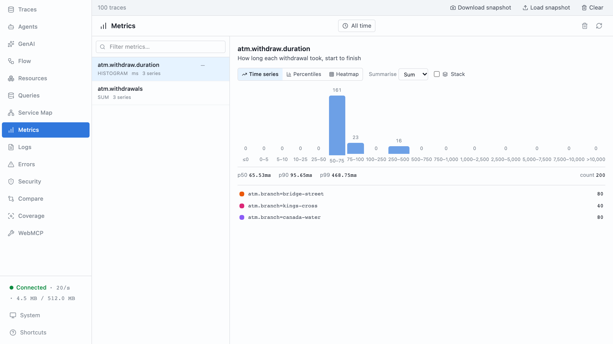
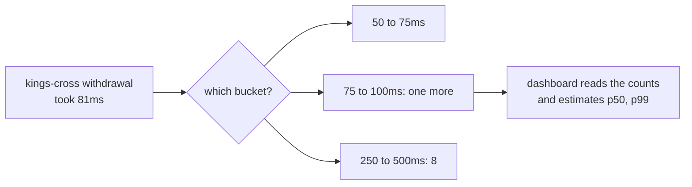

# Part 9: The dashboard

## The scene

Every part so far started with someone already knowing something was wrong.
In production, someone has to notice first.

Operations want a dashboard on the wall: how long withdrawals take at each
branch, and how many withdrawals each branch handles, split by outcome. They
want a year of history, and they want the cost to stay flat whether the
estate handles two hundred withdrawals a day or two million. Keeping every
span for a year fails that last test.

```sh
pnpm ex 09
```

The exercise runs the same 200 withdrawals part 10 will investigate. It sends
spans and wide events, and devtools' Metrics view stays empty.

## Predict, before you run it

> A histogram of withdrawal time, split by branch, costs the same at two
> hundred withdrawals a day or two million. What question will it never be
> able to answer, however long you keep it?

## Your turn

Record two things once per withdrawal, in the `finally` block so refusals
count too:

1. How long the withdrawal took, split by `atm.branch`.
2. One more withdrawal, split by `atm.branch` and `withdrawal.result`.

`createHistogram` and `createCounter` are in `autotel`.

## Our solution

```sh
pnpm sol 09
```

Create each instrument once, at module level:

```ts
const duration = createHistogram('atm.withdraw.duration', {
  unit: 'ms',
  description: 'How long each withdrawal took, start to finish',
});

const withdrawals = createCounter('atm.withdrawals', {
  description: 'Withdrawals, by branch and result',
});
```

Record into them at the end of every withdrawal:

```ts
} finally {
  log.emitNow();

  duration.record(performance.now() - startedAt, {
    'atm.branch': machine.branch,
  });
  withdrawals.add(1, {
    'atm.branch': machine.branch,
    'withdrawal.result': result,
  });
}
```

Open devtools' Metrics view. `atm.withdraw.duration` has one series per
branch. Here is what each one holds after the run:

| Branch        | Withdrawals | 50 to 100ms | 250 to 500ms |
| ------------- | ----------- | ----------- | ------------ |
| bridge-street | 80          | 80          | 0            |
| canada-water  | 80          | 72          | 8            |
| kings-cross   | 40          | 32          | 8            |



The dashboard's verdict: bridge-street is fine, one withdrawal in ten at
canada-water is slow, and one in five at kings-cross is. The numbers are
correct. Hold on to the verdict until part 10.

### Why this solution

**A metric is a number you keep updating.** A span is a record: one per
withdrawal, with every fact attached. A metric keeps no records. It holds a
few running numbers and throws each withdrawal away once it has updated them.
That is why its cost stays flat: two million withdrawals update the same few
numbers as two hundred.

**A counter only goes up.** `withdrawals.add(1)` bumps a running total, the
same tally counter at a door from part 3. The dashboard turns the total into
a rate by comparing it minute to minute: "40 withdrawals a minute at
kings-cross". Use a counter for anything you count: withdrawals, refusals,
retries.

**A histogram keeps counts per range.** A _histogram_ records a spread of
values, such as durations, without keeping them. It splits the number line
into ranges, called _buckets_, and counts how many values land in each. The
defaults are 0 to 5ms, 5 to 10ms, 10 to 25ms, and so on up to 10 seconds. The
table above is the whole of what the histogram stored: bucket counts, plus a
total count, a sum, a minimum and a maximum. It joins the 50 to 75ms and 75 to
100ms buckets, because typical withdrawals take about 75ms and land on either
side of the line from one run to the next.



**A dashboard's p99 is an estimate from those buckets.** Part 10 explains
percentiles in full; for now, the p99 is the time that 99 withdrawals in 100
beat. The histogram no longer knows any single withdrawal's time, so the
dashboard works it out from the counts. For kings-cross:

1. 99% of 40 withdrawals is 39.6, so the p99 sits at the 39.6th fastest.
2. 32 withdrawals fall below 250ms, and 8 fall between 250 and 500ms, so
   the 39.6th is in that bucket, 7.6 of the way through its 8.
3. Assume the 8 spread evenly across the bucket: 250 plus 7.6/8 of 250 gives
   about 488ms.

That is how Prometheus estimates it, and most dashboards do the same. The
slowest real kings-cross withdrawal took about 375ms. The estimate is off by
more than 100ms because the bucket is 250ms wide. You can set narrower
buckets when you create the histogram; the real answer stays a range.

**Labels decide every question the metric can answer.** A _label_ is an
attribute on a metric, such as `atm.branch`. Each distinct combination of
label values becomes its own series, a separate set of running numbers:

- `atm.withdraw.duration` by branch: 3 series.
- `atm.withdrawals` by branch and result: up to 3 × 2 = 6 series.
- Add `user.id` as a label: 25 times as many.
- Add `withdrawal.transaction_id`: one series per withdrawal, and the flat
  cost is gone.

That is part 3's cardinality warning with a price attached. Pick labels with
a handful of values, and pick them before the data arrives. The histogram
cannot split by a field you did not label, which answers the Predict
question: a metric can never tell you which account, customer or card sat
behind a slow withdrawal.

**Metrics leave on a timer.** Spans leave in batches (part 2). Metrics go out
on a schedule: every so often the SDK reads each instrument and sends its
numbers. `shutdown()` sends a final reading, which is why a short script
still delivers them.

### When a metric is the right tool

A metric wins when you know the question in advance and need the answer
cheaply, for a long time:

- **Machine health.** Memory in use, CPU, event loop delay. A log tells you
  the process died because it ran out of memory. A metric shows memory
  climbing toward 90% for the hour before, and an alert on it can page
  someone before the crash.
- **Totals and rates over months.** Withdrawals per branch per day, for a
  year, at a flat cost.
- **Alerts on a known symptom.** Part 7's burn-rate alert counts bad
  withdrawals against a budget. A counter of good and bad withdrawals feeds
  it for almost nothing.

A metric loses when the question is about the individual withdrawal: which
account, which customer, which combination of fields. Part 5's wide event
answers those, and many backends can compute the same charts from wide
events when you ask. You keep both: metrics to notice cheaply, events to
explain.

### What the dashboard told you

kings-cross and canada-water look slow. The numbers are true, and they point
at two branches. An engineer reading this dashboard would book visits to two
ATM sites. Part 10 starts from this dashboard and asks what the slow
withdrawals have in common.

---

Previous: [Part 8: The questions the business asks](../08-events-the-business-asks-for/README.md) ·
Next: [Part 10: Finding the cause](../10-finding-the-cause/README.md)
