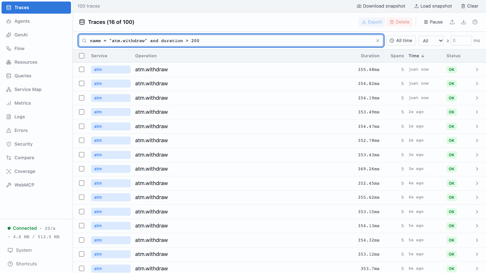
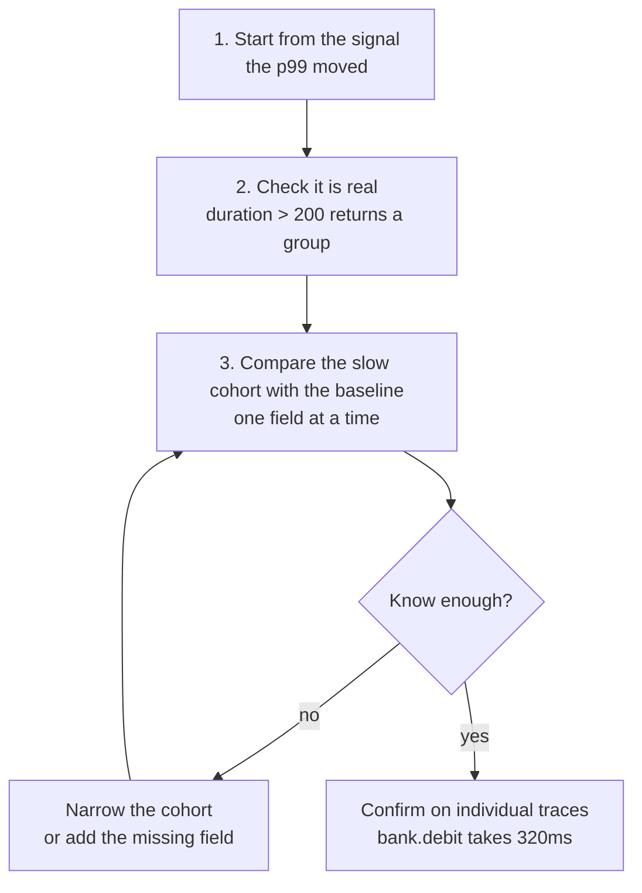
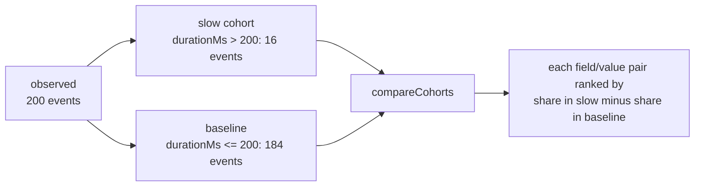
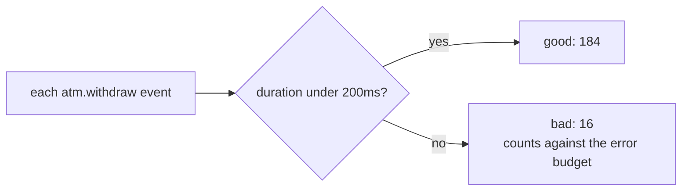

# Part 10: Finding the cause

## The scene

Nobody called and no alert fired. The dashboard you built in part 9 shows the
p99 for withdrawals drifting from 90ms to 400ms over three weeks, while the
p50 has not moved. Split by branch, it blames kings-cross and canada-water.

A **percentile** comes from a line-up. Take 100 withdrawals and sort them from
fastest to slowest. The 50th one's duration is the **p50**, also called the
median: half finished faster. The 99th one's duration is the **p99**: only the
slowest 1% took longer.

The exercise runs two hundred withdrawals across five machines, and a small
**cohort** (a group of events that share some property) is slow. You wrote the
instrumentation, and you do not know which field separates that cohort from
normal traffic.

```sh
pnpm ex 10
```

## Predict, before you run it

> The p50 has not moved and the p99 has quadrupled. Before you look at anything:
> is this a problem that affects all customers a little, or a few customers a
> lot? And what does that tell you about where to look?

## Your turn

Find what the slow withdrawals have in common.

Start in the devtools search box:

```
name = "atm.withdraw" and duration > 200
```



Then work through the fields. Group by `atm.model`, then by `atm.branch`, then
by `withdrawal.amount_pence`. Keep going until you have the answer or run out of
fields.

You will run out of fields, and that is the exercise. When you do, work out what
the event is missing, add it, and run it again.

## Our solution

```sh
pnpm sol 10
```

The solution makes two changes. The first is one line:

```ts
const account = await tracedGetAccount(user.id);
log.set({ account: { id: account.id, shard: account.shard } });
```

The second turns the search into arithmetic. The solution keeps a copy of each
withdrawal's fields and duration in memory, splits them into slow and normal,
and asks `compareCohorts` what separates the two groups:

```ts
const slow = observed.filter((event) => event.durationMs > 200);
const normal = observed.filter((event) => event.durationMs <= 200);

const differences = compareCohorts({
  outlier: slow,
  baseline: normal,
  ignoreFields: ['durationMs'],
});
```

```
16 slow of 200. What separates them:

  field                        value          in slow   in normal
  account.shard                legacy-core       100%         0%
  account.shard                core                0%       100%
  user.id                      u_007              50%         0%
  user.id                      u_019              50%         0%
  atm.branch                   bridge-street       0%        43%
  atm.branch                   kings-cross        50%        17%
```

All 16 slow withdrawals are on `legacy-core`, and none of the 184 fast ones are.
Two accounts never made it off the 1998 core, and each withdrawal against them
spends 320ms in the ledger instead of 40ms. The ATMs, branches and amounts have
nothing to do with it.

With the shard on each event you can rebuild the dashboard's p99 once per shard.
`core` stays near 70ms and `legacy-core` sits near 350ms. Chapter 5 makes the
point: a p99 is one view you compute from raw events, and you can split it by
any field they carry, including one you added this morning.

### Why this solution

**The field you needed describes the account.** `account.shard` says nothing
about the request. A migration the ATM team never ran set it, and no design
document about withdrawals mentions it. Record the context you discover while
the code runs, such as which shard, which plan or which region, because that is
the state that splits one cohort from another.

The standard to aim at, from _Observability Engineering_ (Chapter 1):

> Understand any system state that your application may have gotten itself into,
> even completely novel ones, without shipping new code to handle it (which would
> imply you needed to know about it to find it).

You had to ship code because the event lacked the field. Add it, and widen the
event again each time an investigation finds a gap.

**You started from your guesses, then from the evidence.** The exercise told
you to group by `atm.model`, `atm.branch` and `withdrawal.amount_pence`: fields
you chose because you suspected them. The book calls that _debugging from known
conditions_. It works while the cause sits in a field you already suspect, and
it fails here because nobody suspected the shard. The alternative is to debug
from _first principles_: start from what the data shows, treat each explanation
as a guess to test, and keep what survives. The book calls this process the
**core analysis loop** (Chapter 8). It needs no prior knowledge of the system,
so the person who finds the cause is the most curious one, which need not be
the most senior:



The **baseline** is the normal traffic you compare against: here, the 184
withdrawals that finished in 200ms or less.

Step 3 has three moves, and you can make each one in devtools:

- **Read sample rows.** Open five traces from the slow group and look for any
  value that seems odd. In this run every slow trace spends 320ms in
  `bank.debit`, which tells you the ledger step, though not why.
- **Group by a field.** Split the slow group by `atm.model` and see whether one
  value dominates.
- **Filter.** Keep only the values that look suspicious, make that the new
  cohort, and go round again.

> This loop lets you move forward without needing a preexisting mental model of
> every subsystem. You can use it as a brute-force method to cycle through all
> available dimensions until you identify which ones explain or correlate with
> the outlier within the graph (but remember not to confuse correlation with
> causality).

Step 3 is mechanical, so `compareCohorts` does it for you:



For each field and value, it measures the share of slow events and the share
of baseline events that carry it, then ranks the pairs by the gap, dropping gaps
under 10 points. You stopped grouping by hand at field four; it checks every
field in one call.

Picture a shop comparing the baskets of customers who complained with the
baskets of those who didn't. If one product sits in almost every complainer's
basket and few others, look at that product first.

Honeycomb ships the same idea as BubbleUp, and Chapter 8 walks through a real
incident with it. The tool draws a **heatmap**: time along the bottom, duration
up the side, and each cell coloured by how many requests landed there. You draw
a box around the slow area, and the tool ranks every field by the gap between how often it
shows up inside and outside the box. In their incident one **availability
zone** (one data centre in a cloud region) appeared in 98% of slow events and
17% of the baseline, and the cause turned out to be a network fault in that
zone. Read the size of the gap: `account.shard` at 100% against 0% is a stark
split, while `atm.branch` at 50% against 17% is weaker. The book makes the same
point: the less stark rows are less likely to be causes.

**Bucket your numbers, and keep the raw value.** `withdrawal.amount_pence` takes
four values here. In production it takes any value a customer can type, and a
field whose values never repeat cannot describe a group, so `compareCohorts`
skips it. A **bucket** replaces the number with the range it falls in, like age
bands on a survey. `bucket()` does that when you record the event:

```ts
'withdrawal.amount_band': bucket(amountPence, [1000, 2000, 5000]),
```

With those boundaries, 1500 becomes `1000-2000` and 2500 becomes `2000-5000`.
Keep the raw value as well. Chapter 1 warns that a bucket cannot be undone: once
you store only `1000-2000`, no query can recover 1500. Record both, and group by
whichever the question needs.

**The output contains two traps, and the code avoids a third.** The two traps
are _correlation_ without _causation_: two things show up together because of
something else, and neither causes the other. Umbrellas and wet pavements appear
together because of rain, and the umbrellas did not wet the pavement.

`user.id = u_007` makes up 50% of the slow group and 0% of the normal one. It
looks damning, but it is a _consequence_. `u_007` and `u_019` own the two
accounts on the old shard. Acting on that row would produce a ticket about a
customer and leave the shard alone.

`atm.branch = kings-cross` makes up 50% of slow and 17% of normal. The run
hands out machines by position (withdrawal `n` goes to user `n % 25` and machine
`n % 5`), so every `u_007` withdrawal lands on `atm_0912` at kings-cross and
every `u_019` one on `atm_1204` at canada-water. Fixing kings-cross would change
nothing. Production has the same accident: a customer uses the machine near
home.

This is the trap part 9's dashboard walked into. Its histogram could only
split by the labels you gave it, and branch was the only one. It reported the
truth about branches, and the engineer it sent to kings-cross would have found
two healthy ATMs. The events let you keep asking until a field explains the
split; the metric stops at the labels it has.

The third trap is circular: the field that defines the cohort. `durationMs`
splits slow from normal, so it separates the groups without fail and explains
nothing. The solution passes `ignoreFields: ['durationMs']` to keep it out of
the ranking. Chapter 8 tells of an AI agent that found a field named
`slow_request`, true on every request over 300ms, and blamed it for the
slowness. Any field derived from the outcome belongs in `ignoreFields`.

These traps are why the loop ends with confirmation rather than a conclusion.
Treat the ranking as a hypothesis. Open three `legacy-core` traces and confirm
that `bank.debit` accounts for 320ms in each before you assign the cause.

**When the cause is a combination.** Here one field explains the whole split.
Often a cause needs two or three conditions at once, and several rows tie at
the top of the ranking. Part 13 runs the loop on a slowdown like that, from a
canary deploy.

**Observability tells you where; a debugger tells you why.** Once the traces
point at the ledger call, you reach for a profiler or debugger, with a
`legacy-core` account to reproduce against. Chapter 9 puts it in one line:

> observability is the telescope that helps you aim the microscope.

**Read the two percentiles together.** This answers the Predict question. Line
up 100 withdrawals from this run: 8 are slow, and they fill places 93 to 100.
The 50th is fast, so the p50 does not move. The 99th is slow, so the p99 jumps.
A flat p50 beside a quadrupled p99 means a few customers suffer a lot, and you
should look for what those few share. Percentiles tell you that much and then
stop. They are aggregates, and you need the individual events they came from:

> Aggregation is the key property that distinguishes metrics and what makes them
> extremely economical to use. However, it is also aggregation that hinders
> detailed analysis without already knowing what needs to be aggregated.

That passage comes from Chapter 5. You never knew you needed to aggregate by
shard, and with the raw events you did not have to.

**The raw events also explain why no alert fired.** A threshold alert on the
p99 looks at one number per time window, such as each five minutes, and calls
the whole window good or bad. A slow drift can stay under the threshold for
weeks. Chapter 12 shows the waste in the other direction too: if 94% of a
minute's requests beat 300ms and the target is 95%, the whole minute counts as
bad, though only 6% of requests were slow. Part 7 built the alternative, an
SLI that judges each withdrawal on its own. With "good if it finished in under
200ms", this run has 16 bad withdrawals out of 200, 8%, from the first day of
the drift, and the error budget starts burning that day.



---

Previous: [Part 9: The dashboard](../09-the-dashboard/README.md) ·
Next: [Part 11: One trace, three services](../11-one-trace-three-services/README.md)
