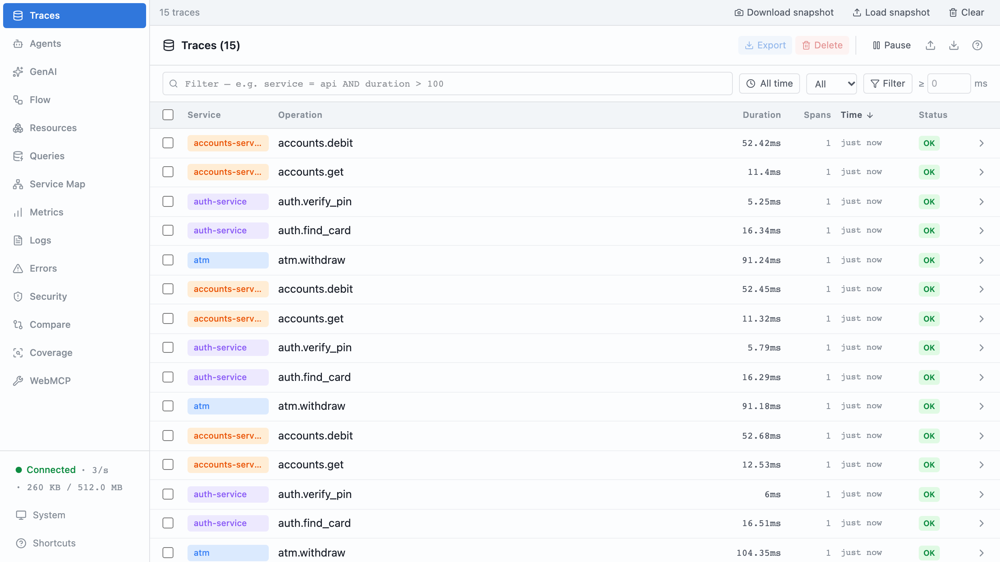
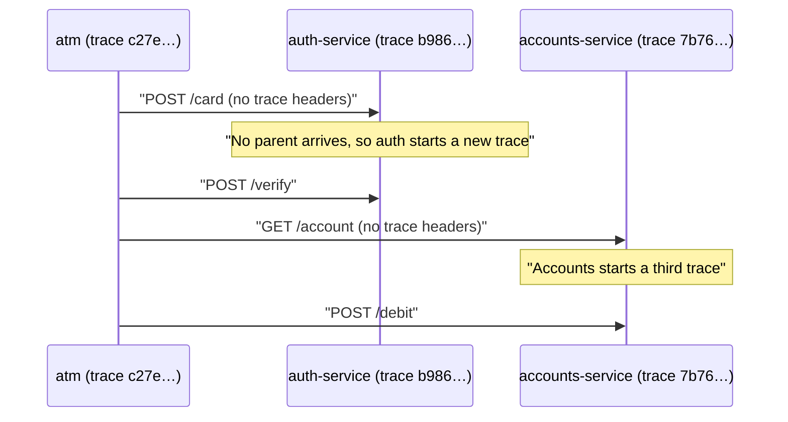
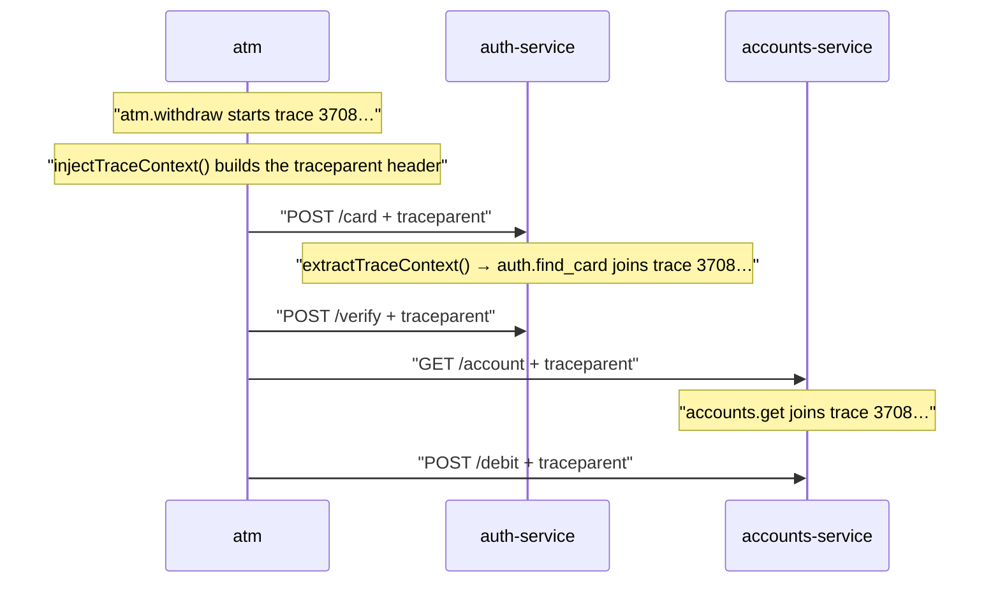
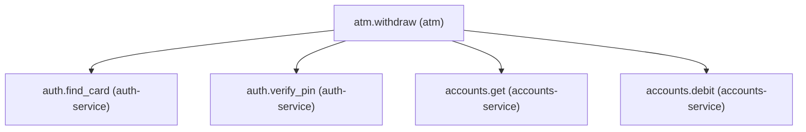
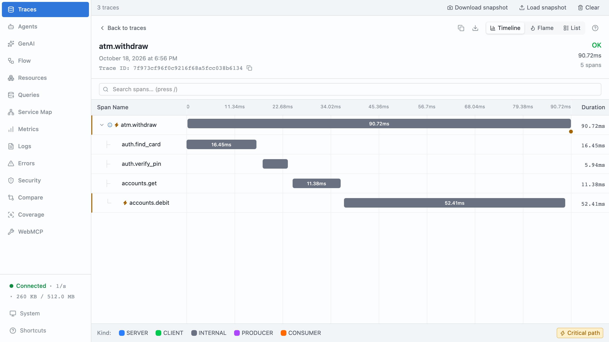
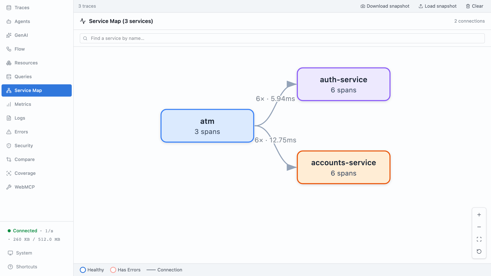
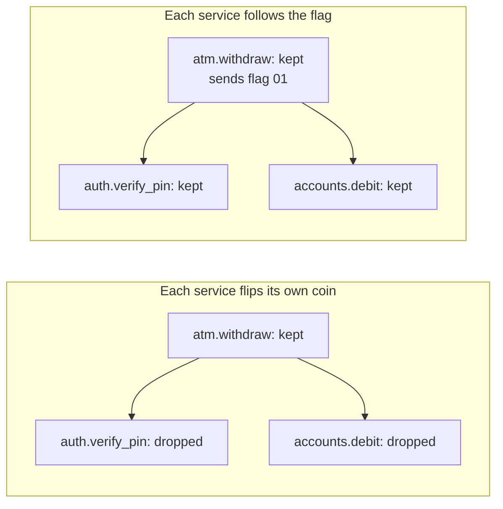

# Part 11: One trace, three services

## The scene

The bank split its one big program, the monolith, into separate services. Auth
runs as its own program now, and so does accounts. The withdrawal still makes the same four calls in the same order,
with the instrumentation you wrote in part 5.

Then the first slow withdrawal came in, and part 10's method stopped working.

```sh
pnpm ex 11
```

The command starts three processes: the ATM, `auth-service` on :7101, and
`accounts-service` on :7102. Each one calls `init()` with its own service name
and exports to the same devtools.

A **process** is one running program. Inside one process your code shares
memory, so autotel can keep the active span in `AsyncLocalStorage`. A **process
boundary** is the gap between two programs. Think of two offices in different
buildings: they share no desk and no filing cabinet, and each one knows only
what arrives in the envelope. Over HTTP, the envelope is the request.

## Predict, before you run it

> Every service is instrumented. Every service exports to the same place. Every
> service names itself. What, precisely, is missing?

## What you get

```
[atm]              trace c27ea9bd14a75c9f2868c9fd31b0561a
[auth-service]     trace b986c311d53f94884701d257d037b884
[accounts-service] trace 7b762d218777b5505473eb50e1b6e865
```

One withdrawal produces three trace ids. Devtools shows three unrelated traces,
and you have no path from the slow one to the reason.





The network split one withdrawal into three records, and none of them knows the
other two exist.

## Your turn

Make one withdrawal produce one trace.

Two functions in `autotel/http` do the job. Find them, and work out which one
belongs on the caller and which on the receiver. The services live in
`services/`, and you may edit them.

## Our solution

```sh
pnpm sol 11
```

On the way out, in the ATM:

```ts
import { injectTraceContext } from 'autotel/http';

const headers = injectTraceContext();
await fetch(`${AUTH}/card`, {
  method: 'POST',
  headers,
  body: JSON.stringify({ card: cardNumber }),
});
```

On the way in, in each service:

```ts
import { extractTraceContext } from 'autotel/http';
import { context } from 'autotel';

const server = createServer((req, res) => {
  const incoming = extractTraceContext(req.headers);
  return context.with(incoming, () => handle(req, res));
});
```

```
[atm]              trace 3708cbb664feab672ca556fecc47f508
                   traceparent: 00-3708cbb664feab672ca556fecc47f508-0c3df08ee0577d1e-01
[auth-service]     trace 3708cbb664feab672ca556fecc47f508
[accounts-service] trace 3708cbb664feab672ca556fecc47f508
```



You get one trace with five spans across three services, and part 10's method
works again:



The ATM calls `injectTraceContext()` once, while `atm.withdraw` is the active
span, and sends the same headers on all four calls. That makes all four service
spans direct children of `atm.withdraw`.

### Why this solution

**Propagation** means carrying the trace identity from one piece of work to the
next, so the next piece knows which trace it belongs to. _Observability
Engineering_ (Chapter 7) names two kinds:

> **Interprocess propagation**: The identity crosses process boundaries, often
> via HTTP headers using W3C TraceContext that include trace ID, parent span ID,
> plus optional baggage (arbitrary key-value pairs) set earlier in a transaction.
>
> **Intraprocess propagation**: The identity flows through methods, threads,
> coroutines, or components inside a process boundary.

You have had intraprocess propagation since part 2. `AsyncLocalStorage` carried
the active span, and child spans nested without anyone naming their parent.
Nothing carries it across a process boundary unless you write it into the
message.

**One HTTP header carries the missing identity.** It works like a case number
at a call centre. When an agent transfers you, you read the number out, and the
next department adds its notes to your case instead of opening a new one.
**W3C Trace Context** is the standard that defines the header, and the header is
called `traceparent`:

```
traceparent: 00-3708cbb664feab672ca556fecc47f508-0c3df08ee0577d1e-01
```

Hyphens split it into four fields. The ids are written in **hex**
(hexadecimal): digits 0 to 9 plus letters a to f, two characters per byte.

| Field            | Value in this run                  | Meaning                                                                                        |
| ---------------- | ---------------------------------- | ---------------------------------------------------------------------------------------------- |
| version          | `00`                               | The format version. Every service today sends `00`.                                           |
| trace id         | `3708cbb664feab672ca556fecc47f508` | 32 hex characters naming the whole withdrawal. Each service copies it unchanged.              |
| parent span id   | `0c3df08ee0577d1e`                 | 16 hex characters naming the span that made the call, here `atm.withdraw`.                    |
| flags            | `01`                               | `01` means the caller is recording this trace, so record yours too. `00` means it dropped it. |

The receiving service creates its own span, gives it the same trace id, and
records `0c3df08ee0577d1e` as its parent. That one step puts `auth.find_card`
under `atm.withdraw` in the waterfall. No vendor owns the format, so a Java or
Python service that reads `traceparent` joins your trace without agreeing on
anything else.





**The last field carries a sampling decision.** A busy system keeps a fraction
of its traces and drops the rest to control cost. That choice is called
**sampling**, and part 12 covers it in depth. In **head-based sampling**, the service
that starts the trace decides, and the book (Chapter 15) describes what happens
next:

> That decision is then propagated further downstream (e.g., by inserting a
> “guarantee sample retention” header bit) to ensure that every span necessary
> to complete the trace is sampled.

The `01` at the end of `traceparent` is that bit. Picture each service instead
flipping its own coin, keeping 1 trace in 10. The ATM keeps a withdrawal, auth drops its
half of the same withdrawal, and accounts keeps its spans for a different one.
You end up with fragments: an `accounts.debit` span with no parent, or an
`atm.withdraw` with holes where its children belong. When each service follows
the caller's flag, the whole trace survives or none of it does. The book calls
this **consistent sampling**. OpenTelemetry's default sampler works this way:
when a request arrives with a `traceparent`, the service copies the caller's
decision instead of making its own.



**Inject on the way out, extract on the way in.** To **inject** is to write the
active context into an outgoing message: the case number goes on the envelope.
To **extract** is to read it back off an incoming message.

- `injectTraceContext()` reads the active span and returns the headers.
- `extractTraceContext(req.headers)` reads those headers and returns a context.
  `context.with(incoming, ...)` runs the handler with that context active, the
  same way `trace()` in part 2 made a span active for everything inside it. Each
  span the service starts then finds a parent, even though the parent lives in
  another process.

**HTTP is one carrier among many.** A **carrier** is whatever holds the context
on its trip. Here it is HTTP headers. Elsewhere it is a header on a queue
message (Kafka, RabbitMQ), gRPC metadata (gRPC's version of headers), or a
`TRACEPARENT` environment variable handed to a child process or CI job. You call
the same two functions and swap the carrier.

A queue changes one thing. The consumer may pick the message up minutes after
the publisher finished, so the context has to live in the message itself. The
book (Chapter 7) connects the two with a **span link** instead of a parent. A
link says "this work was caused by that span over there" without claiming that
one waited for the other. A consumer that handles a batch of 50 messages can
link to all 50 publishers at once.

**Use HTTP instrumentation in a real service.** OpenTelemetry's HTTP
instrumentation injects and extracts for you. Write the two calls by hand once
anyway, because you will debug a broken trace one day, and the bug takes one of
three shapes: the caller did not inject, the receiver did not extract, or a
**proxy** in the middle (a load balancer or gateway that forwards requests)
dropped the header.

**Keep secrets out of the URL.** HTTP instrumentation records the request URL on
the span, in attributes such as `url.full`, so a PIN in a query string would
land in your telemetry. The ATM sends the card number and PIN in the POST body,
which `readJson(req)` in `harness.ts` reads. The user id and amount stay in the
URL because neither is a secret.

**Decide where `traceparent` goes.** It tells the receiver your trace id. Send
it to your own services, and only to a third party on purpose.

### Check your understanding

Break it on purpose. Remove `headers` from one of the four `fetch` calls in
`solution.ts` and run it again. Four spans stay in one trace, and the fifth sits
alone in a trace of its own. You will meet a partially propagated system like
this far more often than one with no propagation at all.

---

Previous: [Part 10: Finding the cause](../10-finding-the-cause/README.md) ·
Next: [Part 12: Facts that travel](../12-facts-that-travel/README.md)
