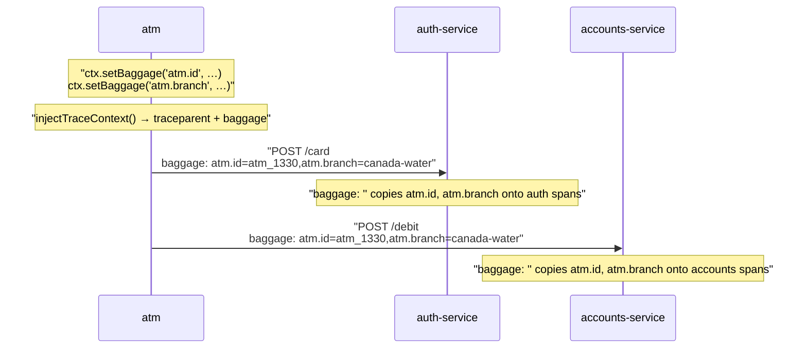
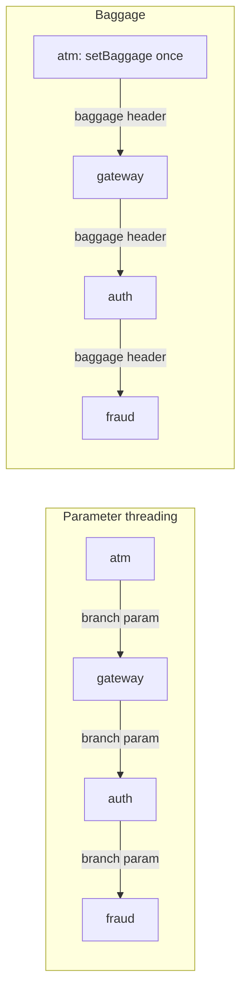
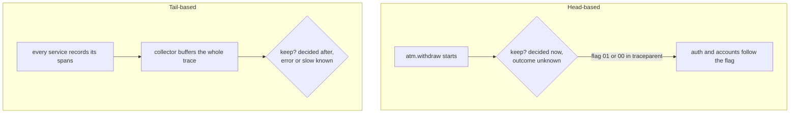

# Part 12: Facts that travel

## The scene

You have one trace across three services, and part 10's method works again. You
go back to it: the accounts service runs slow at one branch and fine at the
others, and you want its spans broken down by branch.

```
service = accounts-service and atm.branch = "canada-water"
```

The query returns nothing. The accounts service has never heard of a branch. It
receives a user id and an amount, because it needs those two to do its job, and
it has no reason to want more.

```sh
pnpm ex 12
```

## Predict, before you run it

> You could add a `branch` parameter to both service calls. Two signatures, ten
> minutes. What breaks when the fourth service is added next quarter, and who
> has to change?

## Your turn

Make `atm.id` and `atm.branch` appear on every span in every service, without
adding a parameter to any function.

You already have most of the mechanism. Part 11's ATM calls
`injectTraceContext()`, which writes a `baggage` header as well as
`traceparent` once the request carries any baggage. The services in
`services-propagated/` already pass `baggage: ''` to `init()`. The missing piece
sits in the ATM.

## Our solution

```sh
pnpm sol 12
```

In the ATM:

```ts
ctx.setBaggage('atm.id', machine.id);
ctx.setBaggage('atm.branch', machine.branch);

const headers = injectTraceContext(); // writes traceparent *and* baggage
```

In every service, one option in `init()`:

```ts
init({ service: 'accounts-service', devtools: true, baggage: '' });
```

On the wire:

```
traceparent: 00-06b5ffc8822c14585e136fb5ccc8c621-4a5bc9eaa8c3fdba-01
baggage:     atm.id=atm_1330,atm.branch=canada-water
```



Six withdrawals alternate between two machines, so three of them run at
`canada-water`. The query that returned nothing now returns those three.

### Why this solution

**Baggage** is a set of key-value pairs that travels with a request, in a
`baggage` HTTP header defined by W3C alongside `traceparent`. If `traceparent`
is the case number from part 11, baggage is a note stapled to the case file.
Each department that handles the case can read it, and nobody has to ask the
customer again. `traceparent` says which trace this is and which span made the
call; baggage carries facts you choose. `injectTraceContext()` writes both
headers and `extractTraceContext()` reads both.

**An attribute stays; baggage travels.** Pick between them on purpose:

|                    | Lives on            | Reaches                                                 |
| ------------------ | ------------------- | ------------------------------------------------------- |
| `ctx.setAttribute` | The span you are in | Nowhere else                                            |
| `ctx.setBaggage`   | The request         | Each instrumented downstream service that propagates it |

Baggage on its own lands on no span. It rides along in the request context
until a service copies it somewhere. `baggage: ''` tells a service to copy each
entry onto each span it creates, under the same name. `baggage: true` adds a
prefix, so the field arrives as `baggage.atm.branch`. The prefix keeps a
travelling value apart from an attribute the service sets itself under the same
name, and costs you extra typing. Pick one convention for all services, because
you cannot group by a field that two services spell two ways.

**Parameter threading makes the middle change.** A `branch` parameter works
until a service that has no use for the branch sits between the ATM and the
service that wants it. That service still has to accept the value and pass it
on.



With threading, a fourth service means you edit four signatures in four
repositories owned by three teams. With baggage, you set the fact once at the
**edge**, the first service a request enters. Each hop passes the header on
untouched, and the new service reads the fact with its own `init()`.

**Baggage costs bytes and trust.** Every propagated request carries the header
to every downstream service:

- Keep it small: a handful of short keys. Treat it as a label, and keep session
  state somewhere else.
- Pick keys you will want to filter by. The header's cost is its length in
  bytes; the cost of many distinct values (part 3's cardinality) arrives later,
  when services copy them onto spans.
- Keep secrets out. The header crosses networks, may show up in proxy logs, and
  leaves your company if you call a third party. A tenant id may fit your
  policy; a customer's name does not. A collector (defined below) can strip
  sensitive fields before they reach your backend (Chapter 16), but it never
  sees the header travelling between two services.

### The other thing baggage can carry

```ts
ctx.setBaggage(AUTOTEL_DEBUG_BAGGAGE_KEY, 'part-10');
```

**Sampling** means keeping a fraction of traces and dropping the rest to control
volume and cost. A **sampler** is the component that makes that call.
_Observability Engineering_ (Chapter 15) separates samplers by when they
decide.

Think of CCTV in a bank. You can decide at the door which customers to film,
or film everyone and keep the footage only for the visits where something went
wrong. Samplers make the same two choices.

**Head-based sampling** decides at the door: when the trace starts, at the ATM.
The decision travels downstream in the `traceparent` flag from part 11. It costs
little and it decides blind:

> there is no way to know if a downstream service call results in an error at
> the time that a head-sampling decision must be made.

That line comes from Chapter 4. A 10% head sampler keeps one refused withdrawal
in ten and drops the other nine, whatever went wrong in them.

**Tail-based sampling** films everyone and decides afterwards, when the status
and duration are known, so it can keep each error and each slow withdrawal. The
catch is storage: something has to hold every span from every service until the
trace ends. The book puts that job outside your code:

> Buffered sampling techniques typically require external collector-side logic.

A **collector** is a separate process that receives telemetry from your
services, holds or transforms it, and forwards it to a backend. Chapter 16
covers collectors as part of a telemetry pipeline.



**What to keep** is a separate choice from when to decide. The book
(Chapter 15) lists the options. **Constant probability** keeps 1 in 10 of
everything. **Sampling by content** sets a rate per kind of event: keep every
refused withdrawal and 1 in 100 of the dull successful ones. **Sampling by
volume** lowers the rate when traffic surges, so a busy Saturday does not flood
your backend.

**Count what each kept trace stands for.** If you keep 1 in 10, each kept
withdrawal stands for 10. With mixed rates, weight each trace by its own rate:
keep every refusal and 1 in 10 of the rest, and 6 kept refusals plus 40 kept
successes means about 6 + 400 = 406 withdrawals. Record the rate on each event
so you can do that sum later. The book (Chapter 15) calls this recording the
sample rate, and it applies to percentiles too: with mixed rates, a p99 over the
kept traces alone gives the wrong answer.

Autotel's `production` sampling preset mixes the approaches. Each process
records every span, then decides as each span ends: keep it if it failed or ran
past one second, and keep one in ten of the rest. Each service decides on its
own, so the book's warning about late decisions applies:

> At best, you may end up keeping the downstream spans deemed interesting
> outliers, but none of the other context.

Your slow `accounts.debit` survives, and the `atm.withdraw` that would tell you
which branch and machine it came from may not.

`autotel.debug` fixes that for one request. Autotel checks for the mark before
its keep-or-drop decision and keeps the span when it finds it. The mark rides in
baggage, so each service the request reaches sees it and keeps its spans, and
you get the whole trace across all three services. You can set it at a gateway, from a feature flag, for one
customer, or with a single `curl`, and investigate without a deploy:

```sh
curl -H 'baggage: autotel.debug=investigating-9f2c' https://atm.internal/withdraw
```

The mark overrides autotel's own keep-or-drop decision. It cannot bring back a
trace that a head sampler declined at the ATM, because nothing filmed that
trace in the first place.

This workshop sets no `sampler` or `sampling` option in `init()`, and every
trace reaches devtools. Here the query shows the marking; the payoff comes in
production, where a sampler drops most traces. Try it in devtools:

```
autotel.debug = "part-10"
```

You get one withdrawal of the six, with spans from all three services.

---

Previous: [Part 11: One trace, three services](../11-one-trace-three-services/README.md) ·
Next: [Part 13: A cause in three parts](../13-a-cause-in-three-parts/README.md)
