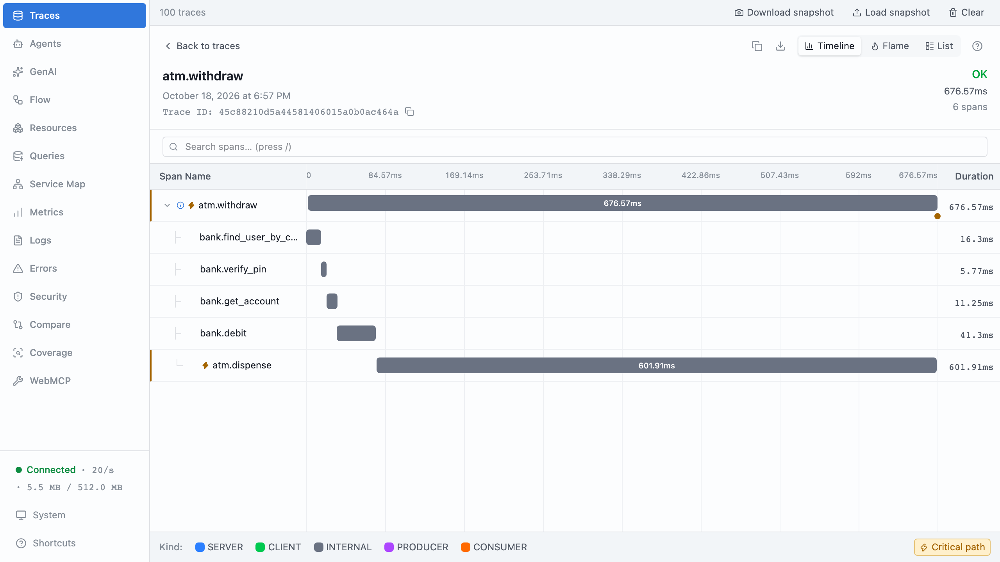

# Part 13: A cause in three parts

## The scene

On Monday, build 4.2.0 of the ATM software went out to four of the ten
machines as a **canary**: a new release given to a small share of traffic
first, so a bad build hurts a few customers instead of all of them. By
Wednesday, some withdrawals take more than half a second to count out the
notes.

The dashboard, split one label at a time, has an opinion:

```
atm.software_version     4.1.3 385ms   4.2.0 676ms
atm.model                NCR-6622 384ms   Diebold-522 676ms   Wincor-2100 385ms
withdrawal.amount_band   <2000 385ms   2000-5000 387ms   >=5000 676ms
atm.branch               bridge-street 675ms   kings-cross 676ms   canada-water 112ms
```

Each row names a suspect. The release team gets a ticket about 4.2.0, the
hardware team gets one about the Diebold machines, someone asks whether large
withdrawals have always been slow, and the branch managers at Bridge Street and
Kings Cross get a phone call. Every one of those p95s is correct.

> **Optional, advanced, about 30 minutes.** This part builds directly on part
> 10 and does not need parts 11 or 12, so a session focused on investigation
> can run it straight after part 10.

This part runs on one process again, and you get no hints. Every field you
need is already on the wide event.

```sh
pnpm ex 13
```

## Predict, before you run it

> Four labels each point at a slow value. Is the cause one of them, all of
> them, or some combination? What would you have to see to tell those apart?

## Your turn

Find what the slow withdrawals share, then prove it. Proving it means showing
the slow group comes back when you filter on your answer, and almost nothing
else does.

Use part 10's loop: in the devtools search box, or with `compareCohorts` on the
`observed` array, which the exercise already fills. Do not open `dispenser.ts`
until you have an answer. Time yourself.

## Our solution

```sh
pnpm sol 13
```

The ranking first, with slow meaning over 500ms:

```
16 slow of 200. What separates them:

  field                    value          in slow   in normal
  atm.model                Diebold-522       100%        35%
  atm.software_version     4.2.0             100%        35%
  withdrawal.amount_band   >=5000            100%        35%
  atm.software_version     4.1.3               0%        65%
  atm.id                   atm_1251           50%         7%
  atm.id                   atm_1266           50%         7%
```

Three rows tie at 100%. Part 10 had one row at the top and stopped there.
Three rows at 100% leave a different question: one cause, or several
conditions that must all hold at once? The solution answers it by testing
every combination of the three suspects:

```ts
const suspects: Array<[string, string]> = [
  ['atm.software_version', '4.2.0'],
  ['atm.model', 'Diebold-522'],
  ['withdrawal.amount_band', '>=5000'],
];

for (let mask = 1; mask < 8; mask += 1) {
  const chosen = suspects.filter((_, i) => mask & (1 << i));
  const matching = observed.filter((event) =>
    chosen.every(([field, value]) => event[field] === value),
  );
  // ...count how many of `matching` were slow
}
```

```
  4.2.0  Diebold  >=5000   withdrawals   slow
  yes      -       -                80     16
   -      yes      -                80     16
  yes     yes      -                40     16
   -       -      yes               80     16
  yes      -      yes               32     16
   -      yes     yes               32     16
  yes     yes     yes               16     16
```

Read the table from the bottom. All 16 withdrawals with all three conditions
are slow. Drop any one condition and the group grows, but the slow count stays
at 16. Every other withdrawal that has one or two of the conditions is fast.
The table has identified the affected cohort: build 4.2.0, on a Diebold
machine, counting out £50 or more. It has not shown why those withdrawals are
slow, or that changing any one condition would fix them. Those take two more
steps.

First, check individual traces, as part 10 taught:

```
atm.software_version = "4.2.0" and atm.model = "Diebold-522" and withdrawal.amount_band = ">=5000"
name = "atm.dispense" and duration > 500
```

The first query returns 16 withdrawals. The second shows each one spending
about 600ms in `atm.dispense`. That tells you where the time goes. Now open
`dispenser.ts` for the mechanism: 4.2.0 replaced the note-mix calculation, and
on Diebold hardware it recalibrates the cassettes before every
mixed-denomination dispense. The code gives you a hypothesis. Change it, run
again, and check the slow cohort changes the way you predicted. That run is
what confirms the hypothesis. The exercise under "Check your understanding"
below walks through one.



### Why this solution

**These dashboard views split by one label at a time.** Each p95 in the scene
is a true statement about one label. Each one also blames a whole value for
what a fifth of its traffic does. Of the 80 withdrawals on 4.2.0, 16 are slow,
and the other 64 are fine. The same holds for the 80 on Diebold machines and
the 80 for £50 or more. A dashboard can show combinations, but only of labels
the metric recorded. To show this one, the metric would need build, model and
amount band as labels. It would then keep a series for every combination of
the three, which is part 9's cardinality bill. You would also have had to
guess, before the incident, that this combination was worth recording. Wide
events record the values and let you combine them when you ask.

The book's own example has the same shape (Chapter 2):

> You can see that the new build is 40% slower for users on the enterprise plan
> hitting the billing endpoint. That signal is available at 1%. By the time it's
> moving aggregate metrics, it's already affecting a lot of people.

This run makes the cohort 8% of traffic so you can see it on a dashboard at
all. At 1% the per-label p95s would not move, and the comparison would still
find it, because it looks at the slow events and not at an average.

**Several rows at 100% means test the combination.** `compareCohorts` scores one
field and value at a time. When the slow cohort is defined by three
conditions, every slow event carries all three, so all three score 100%. The
ranking cannot tell you whether one of them is enough to describe the cohort.
The subset table can. The rule in words: a condition belongs in the description
if removing it lets fast withdrawals into the group. That is a statement about
which withdrawals are affected. The mechanism comes from the traces and the
code, and the proof comes from changing the code and running it again.

**The weaker rows are consequences.** `atm.id = atm_1251` and `atm_1266` sit at
50% each because they are the only two Diebold machines running 4.2.0.
`atm.branch` blames Bridge Street and Kings Cross because those two machines
stand there. Part 10 warned about rows like these. They are real correlations,
and they point at where the cause showed up, not at the cause.

**A known cause sits underneath.** The 385ms p95 on the healthy rows is part 10's
`legacy-core` shard: two accounts in 25 still debit slowly. Setting the cohort
at 500ms keeps that band out of this question. Pick the threshold from the
shape of the data, not from a round number. Two separate slow bands usually
mean two separate causes.

**Record the version, and the canary pays for itself.** The comparison works
because each event carries `atm.software_version`. Part 3 listed
`service.version` for the same reason. In a real estate each ATM process sets it
once, in `init()`, as a resource attribute. Many backends can also draw a
**deploy marker**, a line on every chart at the moment a release went out, so a
chart has a before and an after. The canary gave you a baseline for free: 4.1.3
machines, same hour, same customers. Comparing against it turns "did the deploy
do this?" into a row in a table.

**Use the table to scope the fix, not to choose it.** The cohort suggests three
candidate fixes: roll back 4.2.0, take Diebold machines out of the canary, or
cap the canary at £40. The table tells you how many withdrawals each one would
touch. It cannot tell you that any of them works. The mechanism in
`dispenser.ts` says each one should, and a rerun after the change tells you
whether it did.

### Check your understanding

Change `dispenser.ts` so the slowdown needs only two conditions: drop the
amount check. Before you run it, predict the ranking and the subset table. Then
run `pnpm sol 13` and compare. You should see 40 slow withdrawals, and the
amount band will fall out of the top of the ranking.

---

Previous: [Part 12: Facts that travel](../12-facts-that-travel/README.md) ·
Back to: [the map](../../README.md)
